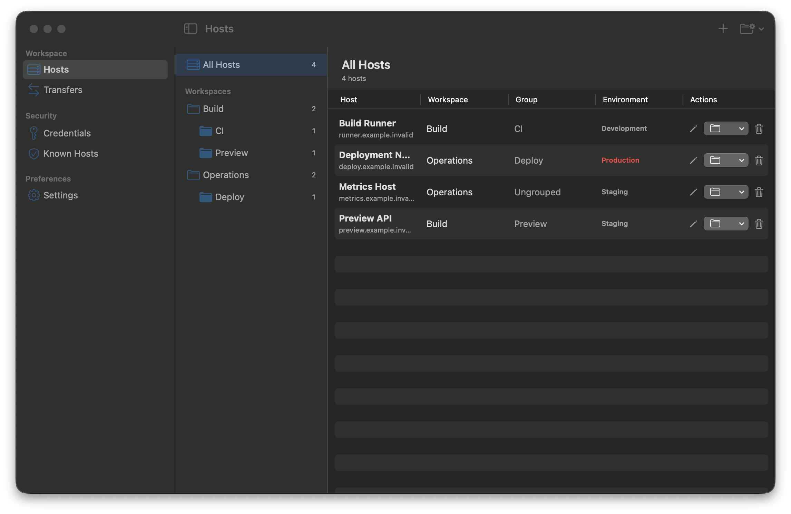
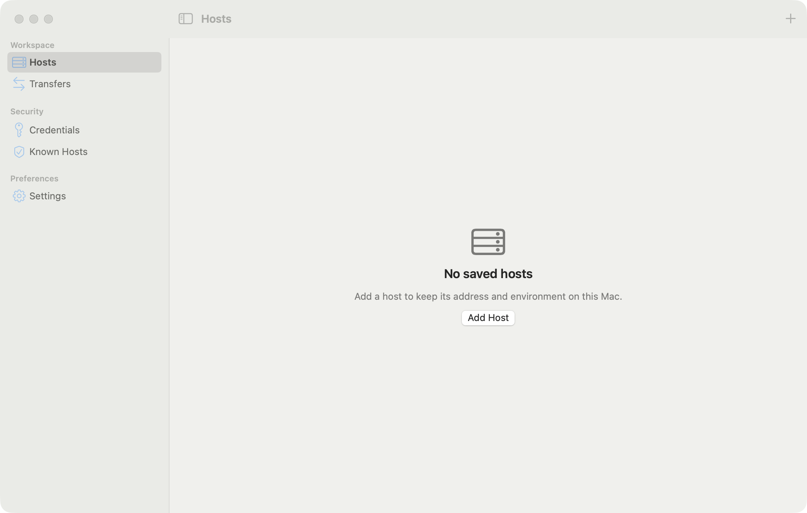

# Mac Remote Workspace

A native, local-first macOS workspace for SSH, SFTP and remote desktops.

## Features

- SSH terminal tabs powered by SwiftTerm, strict host-key verification and Keychain credentials
- SFTP browsing and transfers, ProxyJump and local SSH tunnels
- Embedded RDP using FreeRDP, serial console and command snippets
- Host inventory with metadata import/export; English and Vietnamese interfaces

Requires macOS 14 or later on Apple Silicon or Intel.

## Install and update

Download the app from [GitHub Releases](https://github.com/ngominhtrungcmag/mac-remote-workspace/releases). To update, download and install the new release manually; version 1.0 has no automatic updater.

Release builds are ad-hoc signed, not notarized. If Gatekeeper blocks the app, open it via right-click then Open, or allow it in System Settings, Privacy & Security.

## Build from source

Install Xcode 27 or later (Swift 6.4) and its command line tools, then run:

```sh
./scripts/build-freerdp-macos.sh
swift build
swift test
./bundle-app.sh
```

`./build-native.sh` produces a debug build only; `./bundle-app.sh` already runs it for the release bundle.

The app is produced in `.build/NativeApp/`. `./bundle-app.sh --install` installs it in `/Applications`, backing up an existing app. The FreeRDP build defaults to both architectures; for a single architecture set `ARCHS` for the FreeRDP build and the same value in `MRW_ARCHS` for the bundle, e.g. `ARCHS=arm64 ./scripts/build-freerdp-macos.sh && MRW_ARCHS=arm64 ./bundle-app.sh`.

Open `MacRemoteWorkspace.xcodeproj` and run the shared `MacRemoteWorkspace-App` scheme after building FreeRDP. Select the `MacRemoteWorkspace-App` scheme and My Mac, then open a SwiftUI file and resume Canvas. For command-line builds, use `-scheme MacRemoteWorkspace-App`. Xcode compiles the app sources directly and builds the helper with SwiftPM; select a signing team locally if signing is required. SwiftPM tests run via `swift test`; the Xcode scheme has no Test action.

## Security

Host keys must be explicitly trusted before authentication; mismatches block the connection. Unknown keys require explicit approval. Credentials are stored in Keychain, with app-mediated one-shot secret delivery to ssh and no secret on disk. macOS may ask you to allow Keychain access. See [SECURITY.md](SECURITY.md) for reporting vulnerabilities.

ProxyJump verifies each hop independently. Local tunnels bind only to loopback. SFTP transfers use staging files and require confirmation before overwriting. Downloads report progress; transfers can be cancelled. Metadata exports exclude secrets and host-trust decisions. Embedded RDP uses a separate helper and supports keyboard, pointer and clipboard sharing.

Run `./run-ssh-fixture.sh` and `./run-proxyjump-fixture.sh` for disposable local SSH integration tests.

## Screenshots





## Limitations

- ProxyJump supports one hop and authenticates through the active SSH agent only; Keychain/password credentials are rejected for jump hosts. SFTP and host metrics do not support ProxyJump hosts yet and say so instead of connecting directly.
- SFTP listings are parsed from OpenSSH batch `ls -l` output; a server that deliberately crafts file names containing newlines can display misleading rows.
- Folder upload and dragging files from the SFTP browser to Finder are not supported yet; uploads have no idle timeout (cancel manually), downloads time out after 5 minutes without progress.
- Credentials for the SSH password prompt are delivered through a one-shot FIFO that waits up to 30 seconds for `ssh` to ask.
- RDP credential delivery for CA-validated certificates is deferred until after 1.0.
- SSH tabs are not restored between launches. Embedded RDP interoperability, clipboard behavior and keyboard layouts should be verified against the intended Windows server.
- Updates are installed manually from GitHub Releases.

## Reporting issues

Use GitHub Issues. Report vulnerabilities privately as described in [SECURITY.md](SECURITY.md).

## Contributing and license

See [CONTRIBUTING.md](CONTRIBUTING.md) for development and [LICENSE](LICENSE) for the MIT license.
