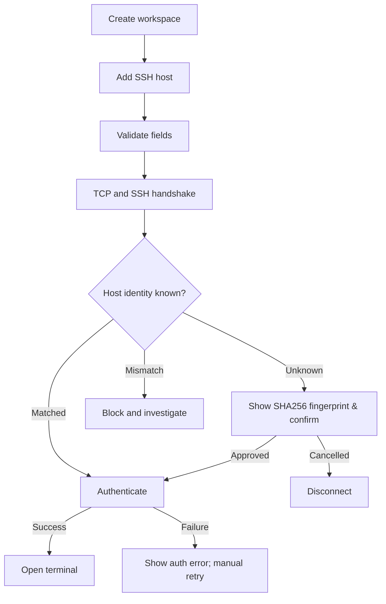

# D03 — User Journey, Flows & State Design

## 1. UJ-01: First-run onboarding

**Actor:** developer lần đầu dùng ứng dụng. **Goal:** tạo SSH connection thành công và hiểu security defaults.

1. Welcome giải thích local-first, no account, secrets dùng Keychain, không tự chạy remote commands.
2. Prompt tạo workspace (ví dụ `Production / Customer A`) hoặc dùng `Personal`.
3. Add Host: display name, FQDN/IP, port=22, username, auth method, environment.
4. Nếu password: lưu vào Keychain sau sự đồng ý. Nếu key: chọn key path bằng file picker; ưu tiên SSH agent nếu sẵn.
5. Connect: thực hiện TCP, SSH negotiation, **host key verification**, rồi mới authentication.
6. Unknown host key: hiển thị algorithm, SHA256 fingerprint, hostname:port, hướng dẫn xác minh bằng kênh độc lập; `Cancel` hoặc `Trust once`/`Trust and save`.
7. Sau auth thành công: mở terminal; SFTP có thể mở trên tab kế bên với cùng profile.

**Errors:** timeout, host-key mismatch, auth denied, bad private-key passphrase, unsupported key, permission denied. Mỗi lỗi có remediation rõ; mismatch tuyệt đối không có nút `Connect anyway` tự động bỏ qua xác minh.

## 2. UJ-02: Production SSH & SFTP

1. User vào customer workspace, chọn host có badge `PROD`.
2. Mở terminal; app hiển thị `username@host` + endpoint + identity status trong tab.
3. User chọn `Open SFTP` → server path hiện rõ ở breadcrumb, local path ở pane bên trái.
4. User upload file, app kiểm tra tên/size, phát hiện conflict, đưa ra lựa chọn Skip/Rename/Overwrite.
5. Upload vào temporary remote target (nếu quyền và SFTP hỗ trợ), verify size/integrity theo capability và rename atomic nếu cùng filesystem; fallback được cảnh báo.
6. Khi cancel, xóa temp do app tạo nếu an toàn; không xóa file đích tồn tại từ trước.
7. Event metadata được ghi: operation, host_id, start/finish/outcome, **không ghi nội dung file**.

## 3. UJ-03: Reconnect from network loss

State `CONNECTED` → `INTERRUPTED`; terminal hiển thị banner, input bị disable; app cho Retry/Close. Retry tạo **session mới**, không replay shell input/paste hay lệnh đã gửi. Nếu network flap, retry throttled với user cancellation. SFTP transfer đang chạy chuyển FAILED/INTERRUPTED và cần explicit retry. Tránh tự động hoàn tất upload trùng file.

## 4. UJ-04: Windows RDP (P1)

User chọn host protocol=RDP → `Open in RDP Client`; nếu client chưa có, app hướng dẫn cài đặt và hiển thị profile details có thể sao chép. Launcher phải dùng API mở tài liệu/profile không chứa mật khẩu, hoặc sinh file cấu hình tạm có permissions chặt và cleanup. Nếu không thể tích hợp an toàn/khả dụng, fallback là copy `host:port` và hướng dẫn mở client. Không claim clipboard/credential sharing với client ngoài.

## 5. UJ-05: Import/export host list

- Export `metadata-only.json` có schema_version, host/group/tags, non-secret connection settings. Credential ref trong export được thay bằng `auth_required=true`, không đi theo máy.
- Import preview: tổng host, duplicate (endpoint/user/protocol), invalid entries, group mapping. Chọn `Skip / Merge metadata / Create copy` trước apply transaction.
- Imported trusted host keys phải được xác minh lại hoặc nhập qua phương thức nâng cao được kiểm soát; không auto-trust fingerprints trong file không xác thực.

## 6. UJ-06: Session close with pending transfer

User đóng tab SFTP khi 2 transfer đang chạy. Dialog hiển thị `Keep transfer running` (nếu app còn chạy) / `Cancel transfers` / `Back`. Khi quit app, chỉ `Cancel + exit` hoặc `Back` cho MVP; tính năng tiếp tục chạy background sau quit chưa hỗ trợ. Transfers phải chuyển state và persist metadata trước khi thoát.

## 7. User-facing states

| Thành phần | States bắt buộc | Thông điệp |
|---|---|---|
| Host list | Empty, Loading, Loaded, Error | First host CTA, search zero results, DB read failure |
| SSH | Idle, Resolving, Connecting, Verifying, Authenticating, Connected, Interrupted, Closing, Closed, Failed | Tên lỗi tách rõ DNS/TCP/trust/auth |
| SFTP | Browsing, Transferring, Paused (nếu hỗ trợ), Cancelled, Failed, Completed | Số bytes thực chuyển, tốc độ, đường dẫn đích |
| RDP external | Client missing, Launching, Launched, Failed | Không hiển thị “Connected” vì app không kiểm soát phiên ngoài |
| Vault | Available, Locked/Prompt, Denied, Not found | Không spam prompt password hoặc auto unlock |

## 8. Keyboard shortcuts (đề xuất)

`Cmd+K`: command palette; `Cmd+N`: new host; `Cmd+T`: new terminal tab; `Cmd+W`: close active tab (cảnh báo transfer); `Cmd+Shift+F`: file search; `Cmd+1/2/3`: switch panels (kiểm tra va chạm với terminal). Toàn bộ shortcut có thể override nếu xung đột với native text input/OS, và được test với layout bàn phím khác nhau.

## 9. Error taxonomy

`DNS_RESOLUTION_FAILED`, `TCP_TIMEOUT`, `TCP_REFUSED`, `HOST_KEY_UNKNOWN`, `HOST_KEY_MISMATCH`, `SSH_NEGOTIATION_FAILED`, `AUTH_FAILED`, `CREDENTIAL_UNAVAILABLE`, `SFTP_PERMISSION_DENIED`, `TRANSFER_INTERRUPTED`, `TRANSFER_CONFLICT`, `RDP_CLIENT_MISSING`, `LOCAL_PERMISSION_DENIED`, `UNEXPECTED_INTERNAL`.

Không hiển thị stack trace cho end-user. `Details` cung cấp event id, code, endpoint redacted và suggested next step.

