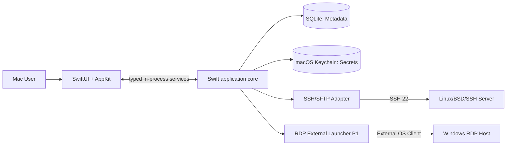
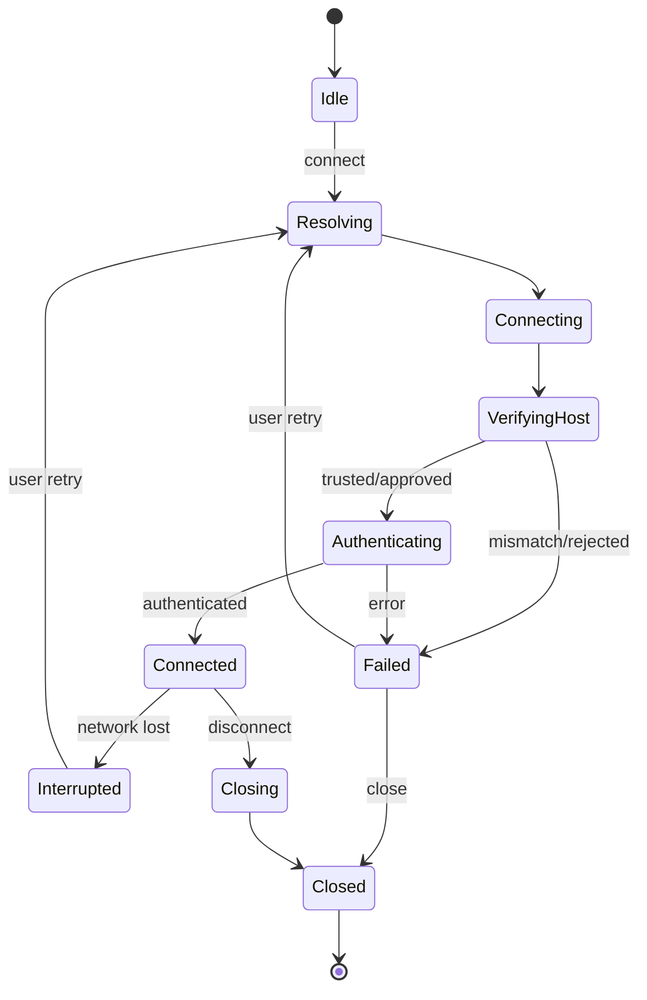
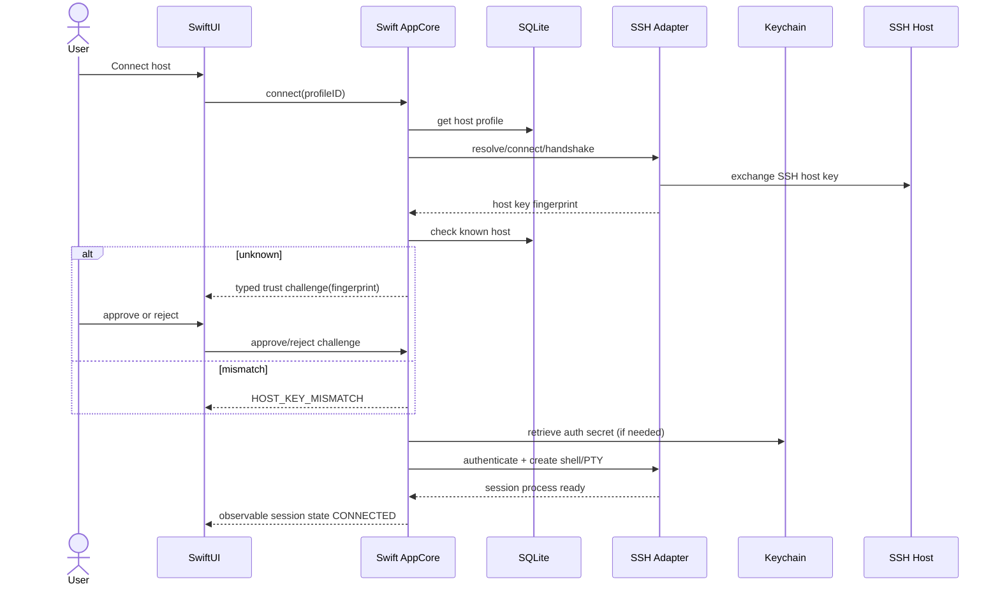
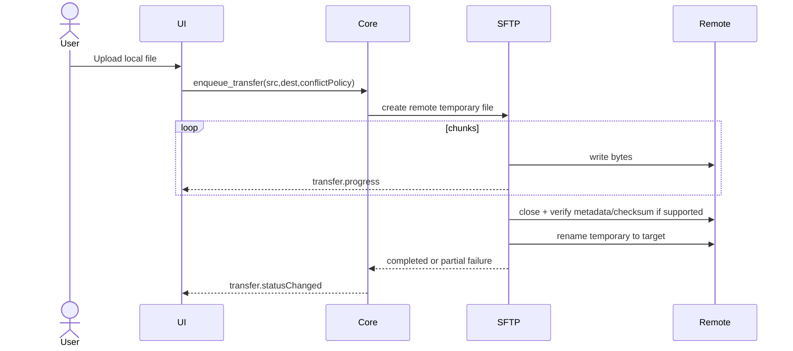

# D05 — Solution Architecture (C4 + Runtime)

## 1. Architecture decision summary

**Kiến trúc được chọn (ADR-010):** ứng dụng macOS native dạng modular monolith, local-first; SwiftUI/AppKit cho UI và app lifecycle, Swift services cho policy và I/O, SQLite migrations cho metadata, macOS Keychain cho secrets. Dùng API hệ thống (Foundation Models, Network, Security, FileManager, NSWorkspace) khi phù hợp. Không yêu cầu backend cloud hoặc agent chạy trên server đích. Bản Tauri hiện có là prototype lịch sử, không phải kiến trúc đích hay nơi phát triển tính năng.



## 2. C4 context

**Person:** desktop user. **System:** Mac Remote Workspace. **External systems:** SSH servers, SFTP subsystem, RDP servers via external client, macOS Keychain, OS file system, local SSH agent, local clipboard. Cloud accounts/telemetry servers không tồn tại trong MVP.

**Trust zones:**

1. SwiftUI view không truy cập repository, Keychain hay transport trực tiếp; mọi input vẫn được validate tại service boundary.
2. Swift core được phép I/O local, Keychain và remote network theo lệnh người dùng; áp dụng least privilege policy nội bộ.
3. Remote hosts và file names/data là untrusted; terminal output/SFTP paths không được coi là trusted HTML/code.
4. External RDP client là process ngoài, không thuộc quản lý session chi tiết của MRW.

## 3. Container/module decomposition

| Package/module | Responsibility | Interface | Ownership |
|---|---|---|---|
| `AppShell` | Native windows, navigation, menus, command palette | SwiftUI/AppKit | macOS UI |
| `TerminalView` | Terminal rendering, input/resize mapping | TerminalSurface | macOS UI |
| `FileBrowser` | Local/remote panes and transfer queue | SFTP service | macOS UI |
| `AppCore` | Policy, orchestration, session registry | Swift services | Swift |
| `HostRepository` | Metadata CRUD and versioned migration | SQLite | Swift |
| `SecretStore` | Keychain refs, access, delete | SecretStore protocol | Swift |
| `SSHTransport` | handshake, verify, auth, PTY | SSH transport protocol | Swift/native dependency |
| `SFTPService` | operations and cancellable transfers | SFTP transport protocol | Swift/native dependency |
| `RDPLauncher` | Open installed RDP application | NSWorkspace | Swift (P1) |
| `FoundationModelService` | On-device explanation and command drafts | Foundation Models framework | Swift (optional) |
| `AuditLog` | Redacted metadata and diagnostics | SQLite/log file | Swift |

## 4. Core design: interfaces, dependency inversion

```text
SwiftUI features -> AppCore policy -> HostRepository/SessionRegistry
                                  -> SSHTransport, SFTPService, SecretStore, RdpLauncher
```

Core không phụ thuộc SwiftUI view. View không thao tác file/Keychain/SSH trực tiếp. Tách protocol adapters cho unit tests với fake server và có thể thay transport nếu spike không đạt.

## 5. Concurrency & threading

- Main actor luôn đáp ứng UI; network I/O and transfer work runs in cancellable Swift tasks or dedicated utility workers.
- The selected system OpenSSH transport runs as a managed `Process` with a fixed executable URL and typed argv. Keep process count bounded, retain its PTY/file descriptors in a session owner, and terminate/reap the process on cancellation or app exit.
- Terminal output uses bounded buffers and backpressure; never drop terminal bytes silently. Measure memory under sustained output.
- SFTP transfers có concurrency mặc định 2 và cap cấu hình; mỗi transfer có cancellation token, state persist độc lập.
- Drain output on the UI update cadence; do not dispatch one main-actor update per byte.

## 6. Session state machine



Every state transition updates a typed Swift observable/session stream. UI code does not infer that a connection succeeded from the request being accepted.

## 7. Data and lifecycle

- Workspace, host/group/settings metadata live in SQLite; secret values are never stored in SwiftUI state beyond the shortest form-entry lifetime.
- On connect, a Swift Keychain service resolves a credential reference only when needed. Keep secret buffers short-lived and clear them best-effort; do not claim full zeroization across system processes.
- Host key được xác minh **trước** auth. Known-hosts file/in-app trust DB cần theo hostname + port + key algorithm và fingerprint; đổi key tạo security event.
- Local files path cần allowlist user-selected scope; không có lệnh arbitrary filesystem từ untrusted UI payload.
- App exit: attempt graceful close, cancel transfer, persist known-safe states, không để SSH/SFTP worker/process orphan.

## 8. Sequence: connect SSH



## 9. Sequence: SFTP atomic upload



Nếu server không hỗ trợ POSIX atomic rename hoặc checksum, app phải chuyển sang fallback có thông báo; không khẳng định tính atomic khi chưa được đảm bảo.

## 10. Performance budgets — proposed, must benchmark

- Cold start target p90 <=3s target reference hardware; inventory render <=200ms với 1,000 hosts từ local DB.
- Session count initial cap: 10 concurrent SSH shells; SFTP transfer concurrency 2; cap configuration và smoke tests.
- RAM budget target TBD từ measurement; không hứa “nhẹ hơn Electron” nếu chưa benchmark.
- App closes idle sessions only with explicit setting and clear warning; no invisible auto-kill.

## 11. Platform strategy

- macOS is the sole supported application target. Do not add Windows/Linux UI or credential-store adapters without a new product decision.
- External RDP is a macOS launcher and its client availability/URL behavior must be tested on supported macOS versions.
- No embedded RDP binary ships until AppKit embedding, signing, Hardened Runtime, codecs and third-party licenses pass a separate feasibility gate.

## 12. Observability and failure recovery

Log có structured fields: timestamp, action_id, host_id hashed/local id, module, duration_ms, error_code; không log password, terminal content, file payload, raw private key, query string chứa token. Audit log cho thay đổi host/credential metadata; log rotation. Crash recovery khôi phục tab placeholders thay vì tự reconnect.


