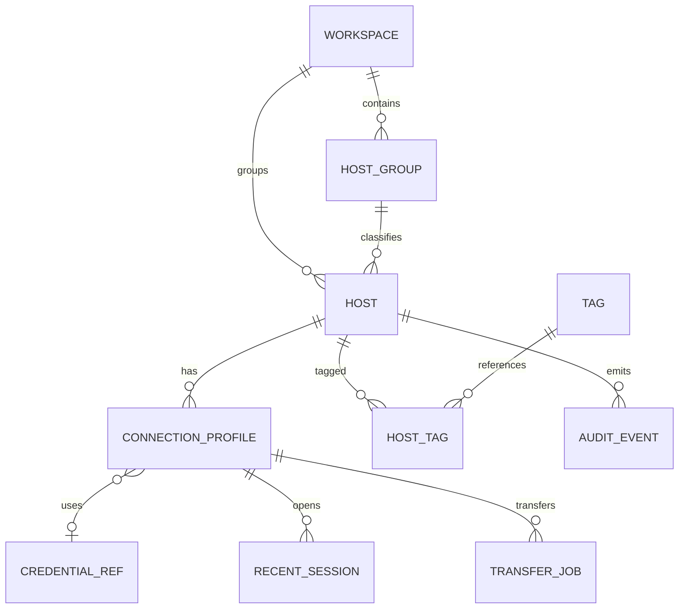

# D06 — Domain Model, ERD & SQLite Schema

## 1. Bounded contexts

- **Inventory:** Workspaces, Groups, Hosts, Tags, SSH/RDP ConnectionProfiles.
- **Identity:** CredentialReferences, TrustedHostKeys (không chứa secret values).
- **Runtime:** Sessions ephemeral + recent session metadata, Transfers durable metadata.
- **Preferences:** AppSettings, LayoutSnapshots, AuditEvents.

## 2. Domain invariants

- Host ID là UUID v7 hoặc UUID v4 (chốt khi implement), không sử dụng hostname làm khóa.
- Một Host có thể có nhiều ConnectionProfile (ví dụ SSH 22 và RDP 3389), mỗi profile có auth reference tùy chọn.
- `CredentialReference` mapping vào Keychain external; DB có thể mất Keychain item, UI phải báo `CREDENTIAL_UNAVAILABLE` và cho rebind.
- `TrustedHostKey` scope hostname:port + algorithm + fingerprint (SHA256); fingerprint không phải bí mật nhưng luôn cần bảo vệ integrity.
- Recent sessions chỉ lưu metadata, không lưu keystrokes, transcript, passwords.
- Transfer source/destination path có thể chứa tên nhạy cảm; retention ngắn và có setting tắt lịch sử.

## 3. ERD



**Implementation note:** dữ liệu `host_group_id` nullable, mặc định một workspace có nhiều groups. Sơ đồ là model khái niệm; constraints chi tiết xem schema.

## 4. Tables

| Table | Primary Key | Main columns | Security note |
|---|---|---|---|
| workspaces | id | name, color, created_at | Không secrets |
| host_groups | id | workspace_id, name, sort_order | FK workspace |
| hosts | id | workspace_id, group_id, display_name, address, environment | Address có thể nhạy cảm; local only |
| connection_profiles | id | host_id, protocol, port, username, credential_ref, options_json | Options JSON allowlist, không secrets |
| credential_refs | id | label, kind, keychain_item_id, created_at | Keychain item_id chỉ là locator, không secret |
| tags | id | name | Unique normalized |
| host_tags | composite | host_id, tag_id | Join table |
| trusted_host_keys | composite | endpoint, key_algorithm, fingerprint_sha256, first_seen | Integrity-critical |
| recent_sessions | id | connection_profile_id, started_at, ended_at, status, error_code | No transcript |
| transfer_jobs | id | connection_profile_id, local_path, remote_path, bytes_total, state | Paths sensitive; short retention |
| audit_events | id | action, entity_id, outcome, error_code, occurred_at | Redacted, no raw payload |
| app_settings | key | json_value | No secrets; schema validation |

## 5. SQL baseline

File `specs/schema.sql` bao gồm các `CREATE TABLE`, FK, CHECK, UNIQUE, INDEX; được dùng làm baseline, không coi là migration production. Database có `PRAGMA foreign_keys=ON` trên mỗi connection; dùng WAL và `busy_timeout` theo QA. Schema version qua `PRAGMA user_version`, future migrations có transactional backups.

## 6. Retention & cleanup

- Audit metadata lưu tối đa 7 ngày và 10 MB mặc định, user có thể vô hiệu hóa hoặc xóa.
- Transfer history lưu 30 ngày mặc định, cho phép clear all; không tự xóa file trên máy chỉ vì xóa record.
- Recent session 90 ngày; no terminal recording.
- Trusted-host entries giữ tới khi user revoke; key mismatch không tự động cập nhật.
- File export luôn metadata-only, không copy local paths/tunnel bind targets nếu chứa bí mật không cần thiết; field inclusion có explicit policy.

## 7. Index and migrations

- `hosts(workspace_id, environment)`, `hosts(display_name COLLATE NOCASE)`, `connection_profiles(host_id, protocol)`, `recent_sessions(started_at DESC)`.
- SQLite FTS5 optional cho fast search sau benchmark; inventory 1k chưa bắt buộc.
- Trước migration: sao lưu metadata database vào file có permission giới hạn, verify free disk; nếu migration fail restore/rollback và show recovery steps. Không tự đồng bộ vào cloud.

## 8. Sample JSON export contract

```json
{
  "schema_version": 1,
  "generated_at": "2026-10-26T13:00:00Z",
  "workspaces": [
    {"id": "c6a81b85-2f53-4d5e-9cd3-d6e0aa6b060c", "name": "Demo"}
  ],
  "hosts": [
    {"id": "cf468f8a-aad7-48a1-91a8-2ab262f66ce3", "workspace_id": "c6a81b85-2f53-4d5e-9cd3-d6e0aa6b060c", "display_name": "Dev Ubuntu", "address": "dev.example.net", "environment": "development"}
  ],
  "connection_profiles": [
    {"host_id": "cf468f8a-aad7-48a1-91a8-2ab262f66ce3", "protocol": "ssh", "port": 22, "username": "developer", "auth_required": true}
  ],
  "secrets_included": false
}
```

Đây là ví dụ minh họa. Import/export schema cuối cùng cần đối chiếu với các Swift `Codable` contracts và migration rules, validate dữ liệu ngoài và transaction trước khi áp dụng. `specs/ipc.types.ts` chỉ thuộc prototype Tauri cũ.


