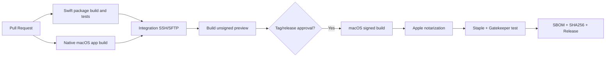

# D11 — Build, Release, Distribution & Operational Runbook

## 1. Environments

- `development`: developer signing ad hoc only; debug data entirely synthetic.
- `integration`: CI artifacts with ephemeral SSH/SFTP test containers; no production secrets.
- `release-candidate`: Developer ID-signed and notarized binary installed on clean test Macs.
- `stable`: public signed DMG/ZIP, checksums, release manifest and notes.

## 2. Proposed repo CI/CD



### Local native commands

```bash
./scripts/build-freerdp-macos.sh
swift build
swift test
./run-ssh-fixture.sh
./build-native.sh
```

The repository's active app is a Swift Package at the repository root. Open `MacRemoteWorkspace.xcodeproj` and run the shared `MacRemoteWorkspace` scheme after building FreeRDP. The scheme has no Test action; run `swift test` separately. Debug builds contain SwiftPM debug information, but Xcode indexing and source breakpoints have not been verified; select a signing team locally if needed. The React/Tauri/Rust build scripts under the old prototype are not release commands. `./run-ssh-fixture.sh` starts only disposable loopback OpenSSH services; never point development tests at production hosts.

## 3. Signing and notarization

- Register Apple Developer ID Application signing cert; store credentials in secure CI secrets, not repository.
- Hardened Runtime on executable+sidecars; no broad entitlements by default.
- `codesign --verify --deep --strict --verbose=2 /path/MacRemoteWorkspace.app` (verification starting point).
- Submit through Apple notary service using Xcode or `xcrun notarytool submit ... --wait` with secret profile, then staple using `xcrun stapler staple ...` where applicable.
- Verify on clean Mac with Gatekeeper enabled (`spctl`, actual Finder launch, app network functions). For sidecar/bundles, inspect code signatures individually.
- Tooling: `./scripts/release-macos.sh [App.app]` (env `DEVELOPER_ID`, `NOTARY_PROFILE`; dry-run when unset) signs nested code including `RdpSessionHelper`, then the bundle, with Hardened Runtime and `scripts/MacRemoteWorkspace.entitlements`, and notarizes/staples. Build the bundle first with `./bundle-app.sh`. Status: tooling only, never executed against Apple (no credentials); TC-020 evidence still outstanding.
- macOS App Store is not promised: sandbox and RDP/SSH integration behavior may require a separate design/entitlements strategy.

## 4. Dependency compliance

Track Swift Package dependencies, native system integrations, and approved RDP clients. Produce an SPDX or CycloneDX SBOM when preparing a release and keep license attributions. FreeRDP is a P2 feasibility candidate only; audit transitive native codecs and optional components before embedding. Run dependency advisory scans and establish a remediation SLA by severity.

Release step (SEC-T08): run `./scripts/sbom-macos.sh` (offline) to regenerate `docs/implementation/SBOM.md` from `Package.resolved` and the FreeRDP/OpenSSL pins in `scripts/build-freerdp-macos.sh`, and commit it. Advisory scanning is a **manual** step: check every SBOM entry (SwiftTerm, swift-argument-parser, FreeRDP, OpenSSL and FreeRDP's transitive codecs) against GitHub Security Advisories / NVD / OSV and record the result in the release evidence.

## 5. Privacy default and support diagnostics

- No telemetry sent automatically; update check opt-in or first-run disclosure if enabled.
- Export diagnostics redacts credentials and terminal content, allows user review before saving/sharing.
- Debug log: local-only, default 7-day rotation, configurable disable; mask host data in public bug reports.
- Settings `Clear History` and `Delete All Local Data` require confirmation; differentiate from Keychain revoke.

## 6. User upgrade and rollback

- Before schema migration backup DB metadata; versioned migrations, recovery on failure.
- Updates cryptographically verified/signed; no executable loaded from untrusted server without verification.
- Downgrade may be incompatible with newer schema; document supported downgrade path; keep backup original metadata for recovery.
- Restore should not overwrite Keychain unexpectedly.

## 7. Support/runbook errors

| Symptom | Diagnosis | User action |
|---|---|---|
| Cannot connect | DNS/TCP timeout/refused | Verify host/port/VPN/firewall |
| Host key mismatch | Changed SSH server key or MITM | Stop, validate host fingerprint out of band |
| Password not accessible | Keychain denied/locked | Unlock/rebind; no plaintext fallback |
| SFTP permission denied | OS permission / remote ACL | Check ownership and selected remote path |
| External RDP not found | Client missing / URL integration changed | Select supported client/copy endpoint |
| App blocked by Gatekeeper | Missing/invalid signing/notarization | Download official signed release, do not disable Gatekeeper |
| Transfer incomplete | Network/disk/permission | Inspect job error and destination .part state before retry |

## 8. Release checklist

Gate checklist sống ở `checklists/release-gates.md`. Stable release requires CHANGELOG, known limitations, license inventory, privacy disclosure, binary checksums, documented supported macOS versions, security contact and reproducible build steps where possible.


## Native release artifacts

Build FreeRDP with `./scripts/build-freerdp-macos.sh`, then bundle with `./bundle-app.sh`. Use `./scripts/release-macos.sh` for signing and notarization with the required credentials. On version tags, CI creates or updates a draft GitHub release and uploads ad-hoc-signed artifacts.
