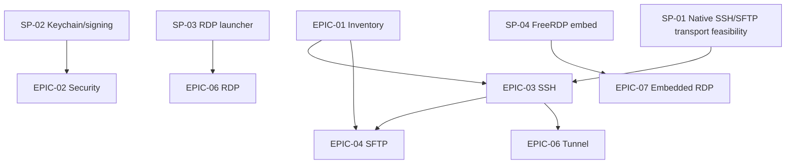

# D12 — Roadmap, Epics, User Stories & Work Breakdown

> **Active implementation target:** Native Swift in `apps/macos/` (ADR-010). Original estimates and prototype-era decisions are planning inputs only. Use `docs/implementation/IMPLEMENTATION_PLAYBOOK.md` for current delivery order and completion status.

## 1. Timeline baseline

Bảng dưới là **ước lượng cho 1 developer có kinh nghiệm làm việc tập trung**, chưa tính lịch cá nhân và các vấn đề native/RDP chưa xác minh. Các milestone có thể thực hiện nối tiếp hoặc song song nếu có đội ngũ.

| Phase | Weeks (estimate) | Deliverable | Gate |
|---|---|---|---|
| M0 Native baseline | Complete only where verified | SwiftUI shell, inventory, SQLite, strict SSH host trust, PTY, external RDP launcher | Per-feature Swift tests and native evidence; partial baseline documented in native README |
| M1 P0 credentials and SSH | Estimate to be reset | Keychain references and explicit SSH auth integrated after trust | TC-003–006, SEC-T03 pass |
| M2 P0 session lifecycle | Estimate to be reset | Managed sessions, terminal behavior, reconnect, cancellation and restoration placeholders | TC-007/011/016/024 pass |
| M3 P0 SFTP and transfers | Estimate to be reset | SFTP browser, queue, cancellation and overwrite safety | TC-008–010 pass on disposable fixture |
| M4 P0 completion and beta | Estimate to be reset | Import/export scope, accessibility, migration recovery, security and release gates | FR/TC traceability and clean-Mac release evidence |
| M5 P1 workflow additions | After P0 dependencies | RDP, local tunnels, ProxyJump, diagnostics and confirmed snippets | Feature-specific security and fixture tests pass |
| M6 P2 feasibility gates | Research-led | Embedded RDP, serial, metrics and other extensions | Explicit go/no-go for each extension |

The original week estimates are not a current schedule. Reset estimates after the Native Swift baseline and remaining P0 gaps are sized; do not reuse Rust-specific effort assumptions.

## 2. Epics with user stories

### EPIC-01 Foundation & Inventory

- **US-001 (P0, 3 pts):** As user, I can create/edit host profile with environment and protocol; acceptance FR-001.
- **US-002 (P0, 3 pts):** I can create workspace/group/tag and move host; FR-002.
- **US-003 (P0, 2 pts):** I can search host by name/tag/environment, keyboard-driven; FR-003.
- **US-004 (P0, 3 pts):** I can import/export metadata safely; FR-014 (after security review).

### EPIC-02 Credentials & Security

- **US-005 (P0, 5 pts):** Save/rebind credentials in Keychain by reference; FR-004, FR-025.
- **US-006 (P0, 5 pts):** Unknown host key is shown for out-of-band verify, mismatch blocks; FR-006.
- **US-007 (P0, 3 pts):** App ships with redacted structured logs, safe external URL policy; FR-013, FR-026.

### EPIC-03 SSH Terminal

- **US-008 (P0, 8 pts):** Connect via SSH password/key/agent, categorized errors; FR-005.
- **US-009 (P0, 5 pts):** PTY terminal tabs, resize, UTF-8; FR-007.
- **US-010 (P0, 5 pts):** Reconnect/manual retry and cleanup; FR-008, FR-027, FR-028.

### EPIC-04 SFTP File Manager

- **US-011 (P0, 5 pts):** Browse remote SFTP paths safely; FR-009.
- **US-012 (P0, 8 pts):** Upload/download queue with cancel/progress and safe temporary strategy; FR-010.
- **US-013 (P0, 5 pts):** Confirm overwrite/delete/rename, show remote target; FR-011.

### EPIC-05 UX & Quality

- **US-014 (P0, 5 pts):** Workspace restore with sessions unconnected by default; FR-012.
- **US-015 (P0, 5 pts):** Keyboard and accessibility; FR-015.
- **US-016 (P0, 5 pts):** Signed/notarized beta with traceability and release checklist; NFR-011.

### EPIC-06 V1.0 additions

- **US-017 (P1, 5 pts):** RDP external launcher with no secrets in args; FR-016.
- **US-018 (P1, 5 pts):** Loopback-only SSH local tunnel; FR-017.
- **US-019 (P1, 3 pts):** DNS/TCP/SSH diagnostics; FR-018.
- **US-020 (P1, 3 pts):** User-approved snippets + command palette; FR-019/020.

### EPIC-07 V2 research

- **US-021 (P2, spike):** FreeRDP native window embedding, keyboard/clipboard/HiDPI benchmark; FR-021.
- **US-022 (P1):** SSH jump host support after host trust chain review; FR-022 and US-027. The P1 priority follows the current user instruction.
- **US-023 (P2):** Readonly server metrics; FR-023.

**Points là relative estimates** để chia việc, không dùng tự động quy đổi thành số giờ chính xác.

## 3. Backlog dependency

## 4. Next implementation slices

**Next slice:** native Keychain credentials and SSH authentication, preserving the existing strict host-trust gate; see `docs/implementation/TASK-01-NATIVE-CREDENTIALS.md`. Deliverable: supported authentication with canary-redaction and negative trust tests.

**Following slices:** complete managed session lifecycle, then validate and implement SFTP browse/transfers on a disposable local fixture. Estimates and sequencing are tracked in the implementation playbook.

## 5. Go/no-go milestones

- **Gate G1-Local:** native SSH/SFTP transport behavior, strict host trust, PTY, cancellation, Keychain, and metadata safety are proven locally on disposable fixtures. Any native SFTP transport choice must have a reproducible feasibility result before product integration.
- **Gate G1-Release:** Developer ID signing, notarization, stapling, Gatekeeper and supported-OS/hardware evidence pass. Local implementation progress never waives this release gate.
- **Gate G2:** Keychain refs survive app restart, deny permission gracefully, no secrets in DB/logs.
- **Gate G3:** SFTP cancellation/retry cannot silently corrupt/overwrite pre-existing target.
- **Gate G4:** P1 RDP launcher safely launches installed client without secrets in argv.
- **Gate G5:** P2 FreeRDP window interaction is validated before setting any V2.0 release date.

## 6. Open-source feature plan

The projects are product research sources only. Reuse workflows and feature ideas; do not copy source, UI assets, or text. Any later code reuse requires checking the exact upstream commit license and all dependency licenses.

| Source | Idea carried into this plan | Phase | Acceptance / gate |
|---|---|---|---|
| Submarine | Dual-pane SFTP, transfer queue, folder mirror, SSH forwarding, optional RDP/VNC | Dual-pane and safe queue P0; loopback tunnel P1; folder mirror and embedded desktop P2 | Transfer conflict/cancel safety; tunnel binds loopback; mirror gets dry-run and deletion preview; desktop protocol spike |
| Retoom | macOS-first local workflow, reusable host context for terminal and files, S3/R2 browsing | Host context P0; S3/R2 deferred P2 | Host profile shared by SSH/SFTP; S3/R2 only after core beta and credentials review |
| Reach | Nested organization, searchable connections, vault, diagnostics, snippets, serial, automation | Groups/search and Keychain P0; diagnostics/snippets P1; serial P2; automation out of scope | Secrets remain Keychain-only; snippets require preview/confirm; serial hardware feasibility gate |
| electerm | Session tabs, quick input, connection hopping, serial/RDP/VNC, themes, optional AI | Tabs P0; jump hosts P1 after trust-chain tests; serial and embedded desktop P2; AI drafts P1 | No broadcast input in MVP; AI drafts only and never executes; user confirms every command |

### Phase assignment

- **P0 native core:** SwiftUI host inventory with nested groups/tags, search and environment badges; Keychain vault references; strict host-key verification; multiple SSH tabs; SFTP dual-pane with queue, progress, cancellation and explicit overwrite handling; keyboard and accessibility support. Preserve no-cloud/local-first behavior.
- **P1 workflow additions:** loopback-only local tunnels, ProxyJump with independent trust checks at every hop, external RDP launcher, redacted connection diagnostics, confirmed snippets, and optional Apple Foundation Models support for selected-error explanations and command drafts. Model access is on-device and capability-checked; unsupported devices retain all non-AI workflows.
- **P2 after measured demand and feasibility:** embedded RDP/VNC, serial console, readonly server metrics, S3-compatible/R2 browser, folder mirroring, and AI queries over explicitly selected app data. Each requires its own security and compatibility gate.
- **Excluded:** cloud vault/sync, unattended command execution, arbitrary remote command APIs, team credential sharing, plugin execution, and broad protocol parity for its own sake.

## 7. New implementation epics

### EPIC-08 Native macOS shell

- **US-024 (P0):** Native SwiftUI navigation, windows, menus, keyboard shortcuts, VoiceOver and appearance; app behavior uses standard macOS conventions.
- **US-025 (P0):** One host profile opens its SSH terminal and SFTP browser while retaining environment and identity context.

### EPIC-09 Workflow additions

- **US-026 (P1):** Create/stop loopback-only SSH tunnels; lifecycle follows the owning SSH session.
- **US-027 (P1):** Configure jump hosts; verify each hop's host key before downstream authentication.
- **US-028 (P1):** Run optional Foundation Models prompts to explain user-selected errors or draft commands; show drafts for editing and explicit confirmation; never execute model output directly.
- **US-029 (P1):** Show redacted DNS/TCP/SSH diagnostics and confirmed connection snippets.

### EPIC-10 Feasibility-gated extensions

- **US-030 (P2):** Prototype embedded RDP/VNC with clipboard, resize, keyboard, TLS/NLA and multi-display test matrix.
- **US-031 (P2):** Prototype serial console against supported USB adapters and document hardware matrix.
- **US-032 (P2):** Evaluate S3/R2 browsing, folder mirror and readonly metrics separately; ship only features validated by user demand and safety review.

## 8. Sample GitHub issue template

