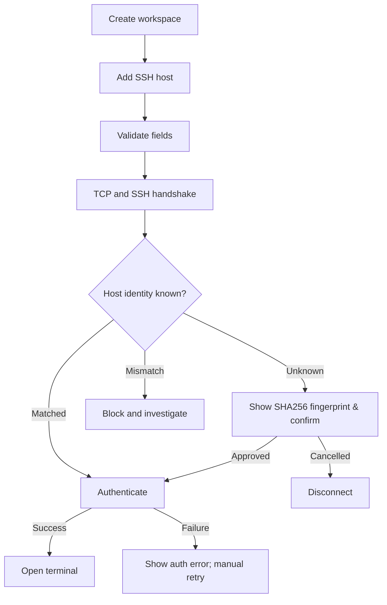
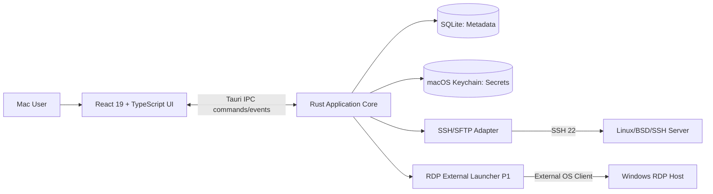
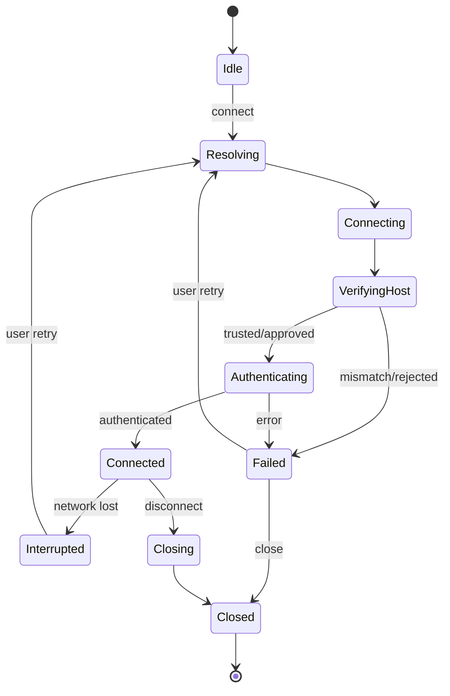
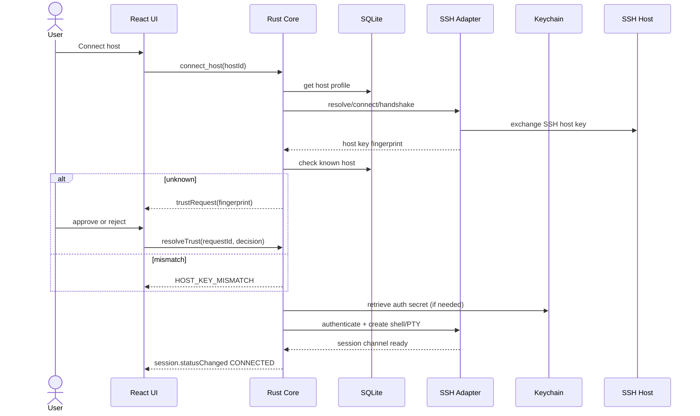
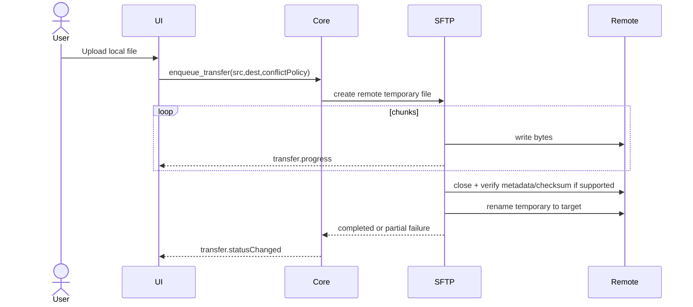
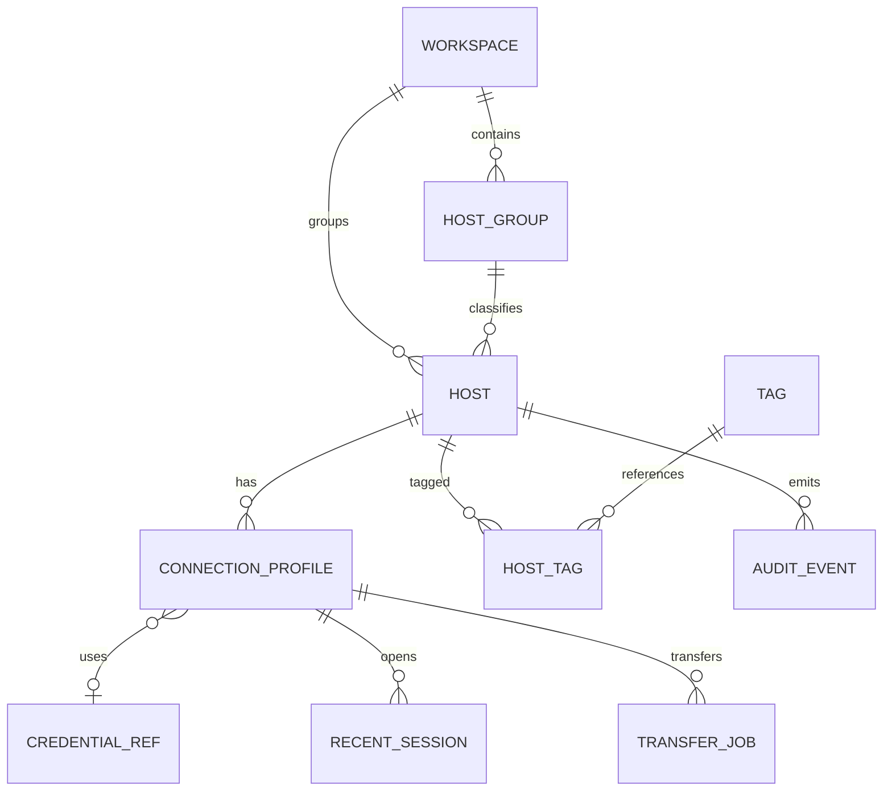
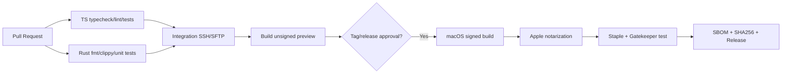
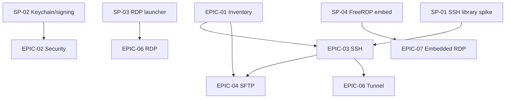

# Thông tin tài liệu

**Trạng thái:** Proposed / implementation planning. **Phạm vi:** macOS-first, local-first, open source.  
**Core stack:** React 19, TypeScript, Tauri 2, Rust, SQLite, macOS Keychain.  
**Lộ trình:** P0 SSH + SFTP + host/workspaces; P1 external RDP + tunnels; P2 embedded RDP qua feasibility gate.  
**Mục đích:** dùng để trao đổi yêu cầu, lập task triển khai, kiểm thử và phê duyệt kiến trúc.  
**Giới hạn:** đây không phải code triển khai; hiệu năng và mức hỗ trợ nền tảng là mục tiêu, chưa được kiểm chứng bằng prototype.

# Hướng dẫn đọc

D01–D04: sản phẩm, yêu cầu, UX. D05–D09: kiến trúc, dữ liệu, giao thức, API, bảo mật. D10–D16: kiểm thử, phát hành, roadmap, quyết định, cộng đồng và triển khai. Các phụ lục code SQL/TypeScript được cung cấp dưới dạng file gốc trong ZIP, không chép vào tài liệu tổng hợp để giữ bản Word dễ đọc.

# D01 — Product Requirements Document (PRD)

## 1. Vấn đề và cơ hội

Developer/IT support phải quản lý cùng lúc máy Linux và Windows của nhiều khách hàng. Họ chuyển qua lại giữa Terminal, ứng dụng RDP, FileZilla/Cyberduck, spreadsheet chứa địa chỉ máy chủ và ghi chú. Việc chuyển ngữ cảnh gây mất thời gian và có nguy cơ nhập lệnh/đẩy file nhầm vào production. Nhiều sản phẩm cạnh tranh đã bao quát SSH, RDP, SFTP (ví dụ Termix); cơ hội không phải “all-in-one đầu tiên”, mà là **workspace macOS-native, local-first, ưu tiên độ rõ ràng của ngữ cảnh và an toàn khi vận hành**.

## 2. Product statement

**Mac Remote Workspace (MRW)** giúp một kỹ thuật viên mở đúng máy chủ, đúng môi trường và đúng giao thức từ một cửa sổ, đồng thời quản lý kết nối, thông tin đăng nhập, phiên làm việc và truyền file theo cách có thể kiểm tra, có thể giải thích, có kiểm soát.

### Giá trị khác biệt cần kiểm chứng

- **Context-first:** máy chủ được nhóm theo khách hàng/dự án/môi trường và hiển thị cảnh báo PROD cố định.
- **Native credential safety:** bí mật không cần cloud account; tích hợp Keychain, SSH Agent.
- **Workflow continuity:** terminal và SFTP có thể dùng chung host profile, mỗi session có lịch sử trạng thái nhưng không ghi nội dung terminal theo mặc định.
- **Reliable transport:** kết nối bị gián đoạn thông báo rõ nguyên nhân, không âm thầm chạy lại lệnh có thể gây tác động.
- **Cross-platform growth:** core adapters có thể tái sử dụng nhưng thiết kế UX ưu tiên macOS trước.

## 3. Personas

| Persona | Bối cảnh | Jobs-to-be-done | Pain point | Ưu tiên |
|---|---|---|---|---|
| P-A Developer fullstack | 5–20 server, Linux/.NET/React | SSH debug, SFTP upload, kiểm tra log | Chuyển app, nhầm host | P0 |
| P-B IT Support | 10–100 host/khách hàng | Mở Windows RDP, hỗ trợ người dùng | Danh bạ rời rạc, credentials khó tìm | P1 |
| P-C SysAdmin | Nhiều environment | SSH tunnel, server file inspect | Cấu hình nguy hiểm khi thiếu context | P0/P1 |
| P-D Agency/Consultant | Nhiều khách hàng | Nhóm workspace, chuyển công việc nhanh | Dễ thao tác trên tenant sai | P0 |

## 4. Top user outcomes

1. Người dùng thêm host Linux và kết nối SSH có xác minh identity trong dưới 2 phút ở happy path (target UX, không phải benchmark).
2. Mở terminal và SFTP của cùng host từ một profile, không nhập lại endpoint.
3. Nhìn thấy rõ môi trường PROD/STAGING/DEV trước mọi thao tác ghi file.
4. Mở RDP của Windows host qua client ngoài, không lộ password ở command-line.
5. Chuyển nhóm khách hàng/workspace, giữ session đang chạy khi đổi tab nếu hệ thống còn khả dụng.

## 5. In-scope / out-of-scope

| Giai đoạn | In scope | Ngoài phạm vi |
|---|---|---|
| P0 MVP | host CRUD; groups/tags; secrets references; SSH terminal; SFTP browser/upload/download; session state; keyboard shortcuts; import/export public metadata; audit metadata | RDP embedded; cloud sync; multiuser; auto script execution; VNC/Telnet; AI agents |
| P1 1.0 | RDP launcher (external), SSH local port forwarding, profiles search, diagnostics; configurable snippets với confirmation | Remote port forwarding mặc định; team credentials; recorded terminal |
| P2 2.0 | Embedded RDP feasibility+shipping, multi-monitor, SSH jump hosts (nếu spike), stats, plugin APIs | Full-blown PaaS; password sharing cloud |

## 6. Success measures — đề xuất sau 60 ngày beta

- Activation: >=60% testers thêm được một host và mở SSH thành công (trên môi trường có network access).
- Task completion: >=90% người thử chuyển từ Host List sang terminal/SFTP không cần hỗ trợ.
- Stability: >=99% app sessions kết thúc không crash trên tập máy beta được theo dõi opt-in hoặc thông qua bug reports.
- Security: 0 secrets trong logs/SQLite/export; 100% mismatch host key bị chặn trong integration tests.
- UX: 90th-percentile mở host profile từ launcher dưới 2 giây trên máy thử định nghĩa; SSH handshake phụ thuộc mạng đo riêng.
- Maintainability: >=80% unit test cho core state machine/validation, không dùng chỉ số này để thay thế end-to-end.

**Lưu ý:** KPI là mục tiêu. Cỡ mẫu beta, thiết bị, loại mạng và cách đo cần đăng ký trước khi công bố.

## 7. Competitor baseline

- Termix: quản lý SSH, RDP, VNC, SFTP, Docker, tunnel và desktop standalone; đây là baseline cạnh tranh, không phải “khoảng trống chưa ai làm”.
- 1Remote: thiên về Windows, hỗ trợ nhiều protocol và launcher.
- FreeRDP: thư viện/protocol engine chứ không phải thiết kế UX.
- Ứng dụng chuyên SSH/SFTP: lợi thế ở độ sâu từng giao thức; MRW không nên cố sao chép đầy đủ ngay.

## 8. Monetization và open-source

Mặc định phần desktop core miễn phí, không yêu cầu tài khoản. Nếu về sau có dịch vụ có phí, chỉ nên là tính năng tùy chọn ngoài core (ví dụ quản lý nhóm với E2EE được thiết kế riêng), và phải công khai mô hình giấy phép. Không được tuyên bố “free forever” nếu chưa có quyết định quản trị dự án.

## 9. Launch narrative

- **Early testers:** developer dùng macOS + Linux VPS; nhỏ gọn, kiểm thử SSH/SFTP và Keychain trước.
- **Public beta:** thêm RDP external launcher, signed+notarized artifact, tài liệu khắc phục lỗi.
- **Post-launch:** tập trung reliability, khảo sát RDP nhúng thay vì cam kết ngày ra mắt.

## 10. Rủi ro định vị

- Quá nhiều tính năng tạo bản clone kém chất lượng; cần ưu tiên workflow có thể đo.
- “Native” có thể bị hiểu là 100% SwiftUI; định nghĩa chính xác: **native desktop packaging/integration trên macOS**, UI được render bởi system WebView qua Tauri.
- Apple notarization/code signing và sandbox có thể ảnh hưởng hỗ trợ file access/sidecar; phải kiểm thử sớm.


# D02 — Software Requirements Specification (SRS)

## 1. Quy ước

MUST = P0, SHOULD = P1, COULD = P2. Tất cả test IDs được đối chiếu trong `checklists/requirements-traceability.csv`. Nhóm module: HOST (H), AUTH (A), SSH (S), SFTP (F), SESSION (E), RDP (R), DATA (D), UX (U), NETWORK (N).

## 2. Functional requirements

| ID | Ưu tiên | Yêu cầu cụ thể | Acceptance criteria (định lượng/xác định) |
|---|---|---|---|
| FR-001 | MUST | Tạo host với tên, address, port, protocol, environment, credential reference | Validate port 1–65535, hostname, required fields; không cho host trống |
| FR-002 | MUST | CRUD host/group/tag với delete confirmation | Xóa host xóa liên kết metadata, không tự xóa secrets được dùng bởi host khác |
| FR-003 | MUST | Search/filter host theo tên, tag, env, protocol | Search không phân biệt chữ hoa thường; debounce; không truy vấn secrets |
| FR-004 | MUST | Vault lưu và tham chiếu password/passphrase trong Keychain | SQLite chỉ lưu UUID `credential_ref`, không chứa giá trị secret |
| FR-005 | MUST | SSH auth password, key file, ssh-agent | Lỗi auth được phân biệt với network/host-key lỗi |
| FR-006 | MUST | SSH host key verification trước auth | Unknown => fingerprint+approval; mismatch => block, không auto trust |
| FR-007 | MUST | Terminal tab, resize PTY, copy/paste, UTF-8 | Resize truyền SSH window change; >=2 tabs cùng lúc |
| FR-008 | MUST | SSH connect/disconnect/retry có state rõ | Retry chỉ tái kết nối session; không chạy lại command đã gửi |
| FR-009 | MUST | SFTP duyệt cây, breadcrumb, file metadata | Có xử lý thư mục rỗng, quyền truy cập, symbolic link |
| FR-010 | MUST | SFTP upload/download với queue, cancel và status | File partial không hiển thị như đã hoàn tất; cancel không phá file đích mặc định |
| FR-011 | MUST | Delete/overwrite/rename trên SFTP với confirm có target path | Production có cảnh báo nâng cao; không cho xóa ngoài lựa chọn |
| FR-012 | MUST | Workspace nhóm host, khôi phục layout/tab metadata | App restart không tự login lại khi chưa consent hoặc secrets locked |
| FR-013 | MUST | Audit event metadata local, redacted | Ghi outcome/error code, không ghi terminal IO hay file contents |
| FR-014 | MUST | Export/import cấu hình không secrets theo versioned schema | Export loại password, private key bytes, fingerprint ngoại lệ; import dry-run và xử lý trùng |
| FR-015 | MUST | Giao diện keyboard-first, light/dark, accessibility | Focus visible, VoiceOver labels, shortcut collision tests |
| FR-016 | SHOULD | Mở RDP từ host profile bằng external client | Không đặt password trong process arguments/URL; hướng dẫn login trong client |
| FR-017 | SHOULD | SSH local port forwarding có quản lý lifecycle | Binding local mặc định `127.0.0.1`; đóng session thì close tunnel |
| FR-018 | SHOULD | Connection diagnostics: DNS, TCP, SSH handshake timing | Kết quả cho biết lớp lỗi; không lưu endpoint credentials vào report |
| FR-019 | SHOULD | Snippet theo host/group, chỉ chạy sau user confirmation | Preview text/target, cấm auto-execute lúc connect |
| FR-020 | SHOULD | Quick switch workspace/command palette | `Cmd+K` hoặc shortcut đã kiểm tra xung đột |
| FR-021 | COULD | RDP embedded view qua FreeRDP native adapter | NLA/TLS, keyboard/clipboard/HiDPI kiểm thử theo matrix trước GA |
| FR-022 | COULD | SSH jump host / ProxyJump | Chain host key validation riêng, không lộ secret downstream |
| FR-023 | COULD | Dashboard server metrics qua safe readonly commands | Có opt-in; xác định distro compatibility |
| FR-024 | COULD | Plugin API cho protocol adapters | Signed manifest/capability model; không chạy untrusted native code ngầm |
| FR-025 | MUST | Credential unlink và orphan cleanup có confirmation | Xóa host không xóa shared credential đang dùng; hiện ảnh hưởng trước action |
| FR-026 | MUST | External link/file path open có kiểm tra | URL schemes allowlist, không shell interpolate input người dùng |
| FR-027 | MUST | Reconnect storm prevention | Exponential backoff, jitter, cap, user cancel; không retry credentials invalid vô hạn |
| FR-028 | MUST | Session close và app quit xử lý active transfer | Nhắc cancel/finish; teardown socket/subprocess không để child sống sót |

## 3. Business rules

- **BR-01:** Host name có thể trùng; host_id UUID là định danh duy nhất. Duplicates có warning dựa trên endpoint nhưng không cấm tuyệt đối (nhiều account).
- **BR-02:** `environment=production` làm thay đổi giao diện cảnh báo và confirmation, không thay quyền truy cập OS.
- **BR-03:** Một credential có thể gắn cho nhiều host qua reference; xóa credential phải hiển thị danh sách liên quan.
- **BR-04:** Session ngắn hạn; đóng app thì in-memory secrets/SSH handles phải bị hủy; chỉ persistence metadata của tab/layout.
- **BR-05:** RDP external launcher không hứa embed, clipboard isolation hoặc seamless credential handoff.
- **BR-06:** Symlink SFTP có thể trỏ ra ngoài folder; mọi thao tác destructive phải hiện canonical/remote path nếu có thể giải được, và thực hiện trên đối tượng người dùng chọn.
- **BR-07:** Không lưu terminal transcript mặc định, không gửi telemetry mặc định; crash report chỉ opt-in.
- **BR-08:** Import không mặc định ghi đè known_hosts; trust decisions phải xác nhận tại máy mới.

## 4. Nonfunctional requirements

| ID | Mục tiêu thiết kế và phương pháp đo |
|---|---|
| NFR-001 Performance | Cold start target p90 <= 3s trên Mac Apple Silicon tiêu chuẩn định nghĩa sau; đo 30 lần, tách startup app và network |
| NFR-002 Responsiveness | Input terminal render mục tiêu không lag dễ nhận thấy với 10 SSH sessions; đo trên LAN/WAN giả lập và payload throughput giới hạn |
| NFR-003 Stability | 8h soak 10 sessions + transfer queue, không memory leak xu hướng tăng vô hạn, không orphan subprocess |
| NFR-004 Security | Không có secrets trong SQLite, logs, exports, crash reports; fuzz validation host/path/events; signed+notarized release |
| NFR-005 Recoverability | Transfer interruption được đánh dấu FAILED/CANCELLED; retry có explicit action; không ghi đè đích khi chưa complete |
| NFR-006 Offline | Host inventory/workspace sử dụng được không mạng; connect fail giải thích rõ |
| NFR-007 Accessibility | WCAG 2.2 AA làm mục tiêu UX; keyboard-only, VoiceOver và reduced motion phải kiểm thử thực tế |
| NFR-008 Compatibility | Baseline target macOS 13+, arm64/x86_64; Xcode/macOS CI matrix có smoke tests; điều chỉnh sau spike |
| NFR-009 Observability | Structured redacted local logs, log retention 7d mặc định, max size/cap theo cấu hình |
| NFR-010 Data integrity | Migrations transactional, rollback khi lỗi; backup metadata trước schema upgrade |
| NFR-011 Packaging | Developer ID signing, hardened runtime, notarization/stapling; SBOM và dependency review |
| NFR-012 Privacy | No-account/no-tracking mặc định; update check tùy chọn, công bố network calls |
| NFR-013 Scalability | Inventory 1,000 hosts vẫn search/filter không lag đáng kể; thử dataset fixture với 10k |
| NFR-014 Maintainability | Core service tách theo domain; protocol engine sau interface; required ADR cho đổi phụ thuộc lớn |

## 5. Constraints / compatibility

- Apple sandbox/security scoped bookmarks cần kiểm tra nếu chọn phân phối qua Mac App Store; kế hoạch đầu tiên Developer ID notarized direct download.
- SSH2 crate dùng libssh2/SSL trên macOS: cần kiểm tra signing và binary dependency.
- FreeRDP native embed chưa được xác thực với Tauri WebView; P2 được coi là **spike-gated**.
- Host trust phải theo hostname+port và key fingerprint, không đơn thuần dựa trên địa chỉ IP.

## 6. Requirement change control

Mỗi thay đổi requirement phải cập nhật mã FR, ưu tiên, acceptance tests, UX và ADR liên quan. Không thể đóng issue nếu acceptance criteria chưa có bằng chứng test/screenshot/log redacted.


# D03 — User Journey, Flows & State Design

## 1. UJ-01: First-run onboarding

**Actor:** developer lần đầu dùng ứng dụng. **Goal:** tạo SSH connection thành công và hiểu security defaults.

1. Welcome giải thích local-first, no account, secrets dùng Keychain, không tự chạy remote commands.
2. Prompt tạo workspace (ví dụ `Production / Customer A`) hoặc dùng `Personal`.
3. Add Host: display name, FQDN/IP, port=22, username, auth method, environment.
4. Nếu password: lưu vào Keychain sau sự đồng ý. Nếu key: chọn key path bằng file picker; ưu tiên SSH agent nếu sẵn.
5. Connect: thực hiện TCP, SSH negotiation, **host key verification**, rồi mới authentication.
6. Unknown host key: hiển thị algorithm, SHA256 fingerprint, hostname:port, hướng dẫn xác minh bằng kênh độc lập; `Cancel` hoặc `Trust once`/`Trust and save`.
7. Sau auth thành công: mở terminal; SFTP có thể mở trên tab kế bên với cùng profile.

**Errors:** timeout, host-key mismatch, auth denied, bad private-key passphrase, unsupported key, permission denied. Mỗi lỗi có remediation rõ; mismatch tuyệt đối không có nút `Connect anyway` tự động bỏ qua xác minh.



## 2. UJ-02: Production SSH & SFTP

1. User vào customer workspace, chọn host có badge `PROD`.
2. Mở terminal; app hiển thị `username@host` + endpoint + identity status trong tab.
3. User chọn `Open SFTP` → server path hiện rõ ở breadcrumb, local path ở pane bên trái.
4. User upload file, app kiểm tra tên/size, phát hiện conflict, đưa ra lựa chọn Skip/Rename/Overwrite.
5. Upload vào temporary remote target (nếu quyền và SFTP hỗ trợ), verify size/integrity theo capability và rename atomic nếu cùng filesystem; fallback được cảnh báo.
6. Khi cancel, xóa temp do app tạo nếu an toàn; không xóa file đích tồn tại từ trước.
7. Event metadata được ghi: operation, host_id, start/finish/outcome, **không ghi nội dung file**.

## 3. UJ-03: Reconnect from network loss

State `CONNECTED` → `INTERRUPTED`; terminal hiển thị banner, input bị disable; app cho Retry/Close. Retry tạo **session mới**, không replay shell input/paste hay lệnh đã gửi. Nếu network flap, retry throttled với user cancellation. SFTP transfer đang chạy chuyển FAILED/INTERRUPTED và cần explicit retry. Tránh tự động hoàn tất upload trùng file.

## 4. UJ-04: Windows RDP (P1)

User chọn host protocol=RDP → `Open in RDP Client`; nếu client chưa có, app hướng dẫn cài đặt và hiển thị profile details có thể sao chép. Launcher phải dùng API mở tài liệu/profile không chứa mật khẩu, hoặc sinh file cấu hình tạm có permissions chặt và cleanup. Nếu không thể tích hợp an toàn/khả dụng, fallback là copy `host:port` và hướng dẫn mở client. Không claim clipboard/credential sharing với client ngoài.

## 5. UJ-05: Import/export host list

- Export `metadata-only.json` có schema_version, host/group/tags, non-secret connection settings. Credential ref trong export được thay bằng `auth_required=true`, không đi theo máy.
- Import preview: tổng host, duplicate (endpoint/user/protocol), invalid entries, group mapping. Chọn `Skip / Merge metadata / Create copy` trước apply transaction.
- Imported trusted host keys phải được xác minh lại hoặc nhập qua phương thức nâng cao được kiểm soát; không auto-trust fingerprints trong file không xác thực.

## 6. UJ-06: Session close with pending transfer

User đóng tab SFTP khi 2 transfer đang chạy. Dialog hiển thị `Keep transfer running` (nếu app còn chạy) / `Cancel transfers` / `Back`. Khi quit app, chỉ `Cancel + exit` hoặc `Back` cho MVP; tính năng tiếp tục chạy background sau quit chưa hỗ trợ. Transfers phải chuyển state và persist metadata trước khi thoát.

## 7. User-facing states

| Thành phần | States bắt buộc | Thông điệp |
|---|---|---|
| Host list | Empty, Loading, Loaded, Error | First host CTA, search zero results, DB read failure |
| SSH | Idle, Resolving, Connecting, Verifying, Authenticating, Connected, Interrupted, Closing, Closed, Failed | Tên lỗi tách rõ DNS/TCP/trust/auth |
| SFTP | Browsing, Transferring, Paused (nếu hỗ trợ), Cancelled, Failed, Completed | Số bytes thực chuyển, tốc độ, đường dẫn đích |
| RDP external | Client missing, Launching, Launched, Failed | Không hiển thị “Connected” vì app không kiểm soát phiên ngoài |
| Vault | Available, Locked/Prompt, Denied, Not found | Không spam prompt password hoặc auto unlock |

## 8. Keyboard shortcuts (đề xuất)

`Cmd+K`: command palette; `Cmd+N`: new host; `Cmd+T`: new terminal tab; `Cmd+W`: close active tab (cảnh báo transfer); `Cmd+Shift+F`: file search; `Cmd+1/2/3`: switch panels (kiểm tra va chạm với terminal). Toàn bộ shortcut có thể override nếu xung đột với xterm/OS, và được test với layout bàn phím khác nhau.

## 9. Error taxonomy

`DNS_RESOLUTION_FAILED`, `TCP_TIMEOUT`, `TCP_REFUSED`, `HOST_KEY_UNKNOWN`, `HOST_KEY_MISMATCH`, `SSH_NEGOTIATION_FAILED`, `AUTH_FAILED`, `CREDENTIAL_UNAVAILABLE`, `SFTP_PERMISSION_DENIED`, `TRANSFER_INTERRUPTED`, `TRANSFER_CONFLICT`, `RDP_CLIENT_MISSING`, `LOCAL_PERMISSION_DENIED`, `UNEXPECTED_INTERNAL`.

Không hiển thị stack trace cho end-user. `Details` cung cấp event id, code, endpoint redacted và suggested next step.


# D04 — UX/UI Design System & Wireframes

## 1. UX principles

1. **Context always visible:** breadcrumb nhóm/host/environment, PROD caution trên mọi terminal/SFTP tab.
2. **One primary action:** New host, Connect, Open SFTP không bị nhấn chìm trong settings.
3. **No ambiguous trust:** host fingerprint và certificate warning không dùng màu “success” hoặc auto-accept.
4. **Keyboard-first:** command palette, navigation tab, accessible focus, shortcut discoverability.
5. **Progress is truthful:** trạng thái “Connecting” ≠ “Connected”; transfer progress dựa trên bytes confirmed.
6. **Reversible by design:** ghi đè/xóa cần xác nhận mục tiêu rõ, không nút destructive đặt sát nút primary.

## 2. Information architecture

```text
Application
├── Home
│   ├── Recents / Favorites
│   ├── Workspace picker
│   └── Search / Command palette
├── Workspaces
│   ├── Groups / Hosts
│   └── Tabs
│       ├── SSH Terminal
│       ├── SFTP File Manager
│       └── RDP External Launcher (P1)
├── Transfers
│   ├── In progress
│   └── Completed/Failed
├── Credentials
│   └── Credential references (never reveal raw secret by default)
├── Known Hosts
│   └── Fingerprint details / review changes
└── Settings
    ├── Appearance & Accessibility
    ├── SSH/SFTP Defaults
    ├── Privacy & Diagnostics
    └── About, Licenses, Updates
```

## 3. Desktop shell wireframe (1440×900 reference)

```text
┌───────────────────────────────────────────────────────────────────────────┐
│ MRW    [Production / Client A ▼]           ⌕ Search hosts      ⚙      │
├─────────────────┬─────────────────────────────────────────────────────────┤
│ Workspaces      │  SSH: ubuntu-prod ●      SFTP: ubuntu-prod             │
│  ▾ Client A     ├─────────────────────────────────────────────────────────┤
│    ● Ubuntu A   │  [PRODUCTION] ubuntu@ubuntu-a.example:22   ● Trusted   │
│    ● Ubuntu B   │                                                         │
│    ◇ Windows DB │  $ systemctl status nginx                                │
│  ▸ Client B     │  ● active (running)                                     │
│                 │  $ _                                                    │
│ Favorites       │                                                         │
│ Recents         │                                                         │
├─────────────────┤                                                         │
│ [+ Add host]    │                                                         │
├─────────────────┴─────────────────────────────────────────────────────────┤
│ Transfers: 1 pending       SSH encrypted · Last network check: 20:21     │
└───────────────────────────────────────────────────────────────────────────┘
```

## 4. SFTP dual-pane wireframe

```text
┌───────────────────────── Local ───────────────────┬──────── Remote ───────┐
│ ~/Projects/build/         ↑                       │ /var/www/site/       ↑│
│ Name                  Size Modified               │ Name              Size│
│ index.html            2KB  Today                  │ index.html         2KB│
│ assets/                —   Today                  │ assets/             — │
│ runtime-config.json  0.3KB Today                  │ runtime-config.json ...│
├───────────────────────────────────────────────────┴───────────────────────┤
│ Transfer queue: uploading assets/app.js 2.1/4.2 MB        [Cancel]       │
└───────────────────────────────────────────────────────────────────────────┘
```

## 5. Design tokens — baseline (không ràng buộc UI library)

| Token | Light | Dark | Ý nghĩa |
|---|---|---|---|
| `bg.base` | `#F7F9FC` | `#10151D` | app background |
| `bg.surface` | `#FFFFFF` | `#18212D` | panels |
| `text.primary` | `#1D2939` | `#F2F4F7` | body |
| `text.secondary` | `#667085` | `#98A2B3` | metadata |
| `accent.primary` | `#246BCE` | `#77ACFF` | main actions |
| `status.success` | `#067647` | `#47C58A` | connected (kèm icon/text) |
| `status.warning` | `#B54708` | `#F3B25B` | trust/production warnings |
| `status.danger` | `#B42318` | `#F97066` | destructive/errors |
| `radius.md` | 8px | 8px | controls |
| `space.unit` | 4px | 4px | 4/8/12/16/24/32 |

Typography: system sans (SF Pro hệ thống, fallback), terminal monospace hệ thống; không bundle font thương mại. Default body 13–14px, content min touch/click target 32×32 desktop, không chỉ dựa vào màu để nhận trạng thái.

## 6. Component inventory

- `AppShell`, `WorkspaceSwitcher`, `HostTree`, `HostCard`, `HostEditor`, `EnvironmentBadge`, `SessionTabs`, `SessionHeader`.
- `SshTerminal`, `TerminalToolbar`, `ReconnectBanner`, `SftpDualPane`, `RemoteBreadcrumb`, `FileRow`, `TransferQueue`, `OverwriteDialog`.
- `CredentialPicker`, `FingerprintDialog`, `KnownHostReviewDialog`, `RdpLaunchPanel`, `Toast`, `ErrorDetails`, `CommandPalette`.

## 7. Responsive and window policy

- Minimum usable window target `1100×700` for dual-pane; below that SFTP panes switch to stacked view; sidebar collapsible.
- Narrow sizes require no horizontal clipping on dialogs, keyboard shortcuts accessible.
- Tauri multi-window: MVP one main window, dialogs as controlled UI overlays. Embedded RDP (P2) requires separate native surface/window lifecycle.

## 8. Accessibility checklist

- Interactive elements have semantic role/label/description; terminal accessible instructions; contrast target WCAG AA.
- VoiceOver navigation order: sidebar → tabs → current content → status/transfer tray.
- Keyboard interaction: tab cycle, Esc dismiss non-critical dialogs, no focus trap except modal, no shortcut stealing terminal characters.
- `prefers-reduced-motion`, dynamic type zoom, clear icon+text statuses, announcements on connection state changes.

## 9. UX acceptance examples

- UXT-01: User recognizes active environment before transferring file.
- UXT-02: Unknown host key shown with actionable fingerprint comparison, reject path is obvious.
- UXT-03: Keyboard-only user can create profile, connect, open SFTP and disconnect.
- UXT-04: Failed transfer shows destination path, reason, and safe retry action.
- UXT-05: Cancel dialog preserves previous host edit values.


# D05 — Solution Architecture (C4 + Runtime)

## 1. Architecture decision summary

**Kiến trúc đề xuất:** Desktop modular monolith, local-first; Tauri 2 WebView cho UI, Rust backend cho I/O và policy enforcement. SQLite chỉ lưu metadata. Keychain lưu small secrets. Không yêu cầu backend cloud hoặc agent chạy trên server đích.



## 2. C4 context

**Person:** desktop user. **System:** Mac Remote Workspace. **External systems:** SSH servers, SFTP subsystem, RDP servers via external client, macOS Keychain, OS file system, local SSH agent, local clipboard. Cloud accounts/telemetry servers không tồn tại trong MVP.

**Trust zones:**

1. UI WebView là untrusted relative to Rust privileged core; IPC validation bắt buộc.
2. Rust core được phép I/O local, Keychain và remote network theo lệnh người dùng; phải áp dụng least privilege policy nội bộ.
3. Remote hosts và file names/data là untrusted; terminal output/SFTP paths không được coi là trusted HTML/code.
4. External RDP client là process ngoài, không thuộc quản lý session chi tiết của MRW.

## 3. Container/module decomposition

| Package/module | Responsibility | Interface | Ownership |
|---|---|---|---|
| `ui-shell` | Layout, navigation, dialogs, command palette | hooks + feature stores | Frontend |
| `ui-terminal` | xterm.js presentation, input/resize mapping | TerminalPort | Frontend |
| `ui-files` | local/remote file lists + transfer queue | SftpPort | Frontend |
| `ipc-contract` | Types, versioning, validation | typed commands/events | Shared |
| `app-core` | Policy, orchestration, session registry | Rust commands | Rust |
| `host-repository` | Metadata CRUD & migration | SQLite | Rust |
| `secret-store` | Keychain refs, unlock/delete | SecretStore trait | Rust |
| `ssh-transport` | handshake, verify, auth, shell channels | SshTransport trait | Rust |
| `sftp-service` | operations, transfer workers | FileTransfer trait | Rust |
| `rdp-launcher` | external RDP client integration | RdpLauncher trait | Rust (P1) |
| `event-hub` | bounded event queue, stream lifecycle | Tauri events | Rust |
| `audit-log` | redacted metadata and diagnostics | SQLite/log file | Rust |

## 4. Core design: interfaces, dependency inversion

```text
UI (features) -> typed invoke layer -> app-core policy
                                -> HostRepository/SessionRegistry
                                -> SSHTransport, SFTPService, SecretStore, RdpLauncher
```

Core không phụ thuộc React component. UI không thao tác file/Keychain/SSH trực tiếp. Tách protocol adapters cho unit tests với fake server và khả năng thay thế libssh2 nếu có vấn đề tương thích.

## 5. Concurrency & threading

- Tauri event loop luôn đáp ứng UI, không chạy blocking libssh2 trên UI thread.
- Nếu dùng `ssh2` (Rust binding tới libssh2, sync), mỗi session chạy trong dedicated blocking worker/thread với bounded worker budget, message queue điều khiển, cancellation token; **không chia sẻ session handle tùy tiện giữa nhiều thread**.
- Terminal output stream có bounded buffer; backpressure hoặc drop behavior chỉ áp dụng diagnostics event, **không bỏ dữ liệu terminal tùy ý**. Với output quá lớn cần flow control/đọc có giới hạn, đo memory.
- SFTP transfers có concurrency mặc định 2 và cap cấu hình; mỗi transfer có cancellation token, state persist độc lập.
- UI render throttled theo animation frame; terminal nhận chunk hợp lý, không gửi mỗi byte qua Tauri event.

## 6. Session state machine



Mọi state transition tạo typed event `session.statusChanged`; frontend không giả định thành công từ lệnh `connect` trả về việc request đã được nhận.

## 7. Data and lifecycle

- `app_state` snapshot metadata, host/group/settings trong SQLite; secret value không được cache vào Redux store hoặc localStorage.
- On connect, Rust `SecretStore` lấy secret theo ref; giữ trong memory ngắn nhất có thể. Đóng session xóa reference buffers/handle best-effort; zeroization có giới hạn khi FFI/library giữ bản sao.
- Host key được xác minh **trước** auth. Known-hosts file/in-app trust DB cần theo hostname + port + key algorithm và fingerprint; đổi key tạo security event.
- Local files path cần allowlist user-selected scope; không có lệnh arbitrary filesystem từ untrusted UI payload.
- App exit: attempt graceful close, cancel transfer, persist known-safe states, không để SSH/SFTP worker/process orphan.

## 8. Sequence: connect SSH



## 9. Sequence: SFTP atomic upload



Nếu server không hỗ trợ POSIX atomic rename hoặc checksum, app phải chuyển sang fallback có thông báo; không khẳng định tính atomic khi chưa được đảm bảo.

## 10. Performance budgets — proposed, must benchmark

- Cold start target p90 <=3s target reference hardware; inventory render <=200ms với 1,000 hosts từ local DB.
- Session count initial cap: 10 concurrent SSH shells; SFTP transfer concurrency 2; cap configuration và smoke tests.
- RAM budget target TBD từ measurement; không hứa “nhẹ hơn Electron” nếu chưa benchmark.
- App closes idle sessions only with explicit setting and clear warning; no invisible auto-kill.

## 11. Cross-platform strategy

- P0 macOS Keychain provider. Windows: Credential Manager; Linux: Secret Service/libsecret (future adapters).
- macOS RDP external launcher là P1; platform-specific availability và supported CLI/options phải kiểm thử.
- UI components và domain model portable; protocol feature flags riêng theo OS.
- No shared native RDP binary shipping cho tới khi signing, Hardened Runtime, codecs và third-party licenses được audit.

## 12. Observability and failure recovery

Log có structured fields: timestamp, action_id, host_id hashed/local id, module, duration_ms, error_code; không log password, terminal content, file payload, raw private key, query string chứa token. Audit log cho thay đổi host/credential metadata; log rotation. Crash recovery khôi phục tab placeholders thay vì tự reconnect.


# D06 — Domain Model, ERD & SQLite Schema

## 1. Bounded contexts

- **Inventory:** Workspaces, Groups, Hosts, Tags, SSH/RDP ConnectionProfiles.
- **Identity:** CredentialReferences, TrustedHostKeys (không chứa secret values).
- **Runtime:** Sessions ephemeral + recent session metadata, Transfers durable metadata.
- **Preferences:** AppSettings, LayoutSnapshots, AuditEvents.

## 2. Domain invariants

- Host ID là UUID v7 hoặc UUID v4 (chốt khi implement), không sử dụng hostname làm khóa.
- Một Host có thể có nhiều ConnectionProfile (ví dụ SSH 22 và RDP 3389), mỗi profile có auth reference tùy chọn.
- `CredentialReference` mapping vào Keychain external; DB có thể mất Keychain item, UI phải báo `CREDENTIAL_UNAVAILABLE` và cho rebind.
- `TrustedHostKey` scope hostname:port + algorithm + fingerprint (SHA256); fingerprint không phải bí mật nhưng luôn cần bảo vệ integrity.
- Recent sessions chỉ lưu metadata, không lưu keystrokes, transcript, passwords.
- Transfer source/destination path có thể chứa tên nhạy cảm; retention ngắn và có setting tắt lịch sử.

## 3. ERD



**Implementation note:** dữ liệu `host_group_id` nullable, mặc định một workspace có nhiều groups. Sơ đồ là model khái niệm; constraints chi tiết xem schema.

## 4. Tables

| Table | Primary Key | Main columns | Security note |
|---|---|---|---|
| workspaces | id | name, color, created_at | Không secrets |
| host_groups | id | workspace_id, name, sort_order | FK workspace |
| hosts | id | workspace_id, group_id, display_name, address, environment | Address có thể nhạy cảm; local only |
| connection_profiles | id | host_id, protocol, port, username, credential_ref, options_json | Options JSON allowlist, không secrets |
| credential_refs | id | label, kind, keychain_item_id, created_at | Keychain item_id chỉ là locator, không secret |
| tags | id | name | Unique normalized |
| host_tags | composite | host_id, tag_id | Join table |
| trusted_host_keys | composite | endpoint, key_algorithm, fingerprint_sha256, first_seen | Integrity-critical |
| recent_sessions | id | connection_profile_id, started_at, ended_at, status, error_code | No transcript |
| transfer_jobs | id | connection_profile_id, local_path, remote_path, bytes_total, state | Paths sensitive; short retention |
| audit_events | id | action, entity_id, outcome, error_code, occurred_at | Redacted, no raw payload |
| app_settings | key | json_value | No secrets; schema validation |

## 5. SQL baseline

File `specs/schema.sql` bao gồm các `CREATE TABLE`, FK, CHECK, UNIQUE, INDEX; được dùng làm baseline, không coi là migration production. Database có `PRAGMA foreign_keys=ON` trên mỗi connection; dùng WAL và `busy_timeout` theo QA. Schema version qua `PRAGMA user_version`, future migrations có transactional backups.

## 6. Retention & cleanup

- Audit metadata lưu tối đa 7 ngày và 10 MB mặc định, user có thể vô hiệu hóa hoặc xóa.
- Transfer history lưu 30 ngày mặc định, cho phép clear all; không tự xóa file trên máy chỉ vì xóa record.
- Recent session 90 ngày; no terminal recording.
- Trusted-host entries giữ tới khi user revoke; key mismatch không tự động cập nhật.
- File export luôn metadata-only, không copy local paths/tunnel bind targets nếu chứa bí mật không cần thiết; field inclusion có explicit policy.

## 7. Index and migrations

- `hosts(workspace_id, environment)`, `hosts(display_name COLLATE NOCASE)`, `connection_profiles(host_id, protocol)`, `recent_sessions(started_at DESC)`.
- SQLite FTS5 optional cho fast search sau benchmark; inventory 1k chưa bắt buộc.
- Trước migration: sao lưu metadata database vào file có permission giới hạn, verify free disk; nếu migration fail restore/rollback và show recovery steps. Không tự đồng bộ vào cloud.

## 8. Sample JSON export contract

```json
{
  "schema_version": 1,
  "generated_at": "2026-10-26T13:00:00Z",
  "workspaces": [
    {"id": "c6a81b85-2f53-4d5e-9cd3-d6e0aa6b060c", "name": "Demo"}
  ],
  "hosts": [
    {"id": "cf468f8a-aad7-48a1-91a8-2ab262f66ce3", "workspace_id": "c6a81b85-2f53-4d5e-9cd3-d6e0aa6b060c", "display_name": "Dev Ubuntu", "address": "dev.example.net", "environment": "development"}
  ],
  "connection_profiles": [
    {"host_id": "cf468f8a-aad7-48a1-91a8-2ab262f66ce3", "protocol": "ssh", "port": 22, "username": "developer", "auth_required": true}
  ],
  "secrets_included": false
}
```

Đây là ví dụ minh họa. **Import/export schema cuối cùng cần đối chiếu với TypeScript type declarations**, validate dữ liệu ngoài và transaction trước khi áp dụng.


# D07 — SSH, SFTP, RDP, Tunnels & Session Lifecycle

## 1. SSH design

**Selection candidate:** Rust `ssh2` crate (bindings tới libssh2). Lợi thế: SSH client + SFTP + ssh-agent support, mature protocol stack. Hạn chế: API blocking và phụ thuộc native/OpenSSL; cần dedicated workers, supply-chain scan, platform compilation matrix. Quyết định cuối cùng sau Spike SP-01; nghiên cứu `russh` như alternative nếu case khác biệt chứng minh.

### Handshake và trust

1. Validate host profile (`address`, `port`, `username`, auth kind).
2. DNS resolve + TCP connect với timeout/cancel.
3. SSH key exchange, lấy public host key/algorithm và tính SHA256 fingerprint.
4. Kiểm tra known-hosts theo hostname+port; matched cho phép auth, unknown phải được người dùng chấp nhận, mismatch block hard.
5. Auth via password or key/ssh-agent; SSH agent identities phải được người dùng chọn nếu có nhiều lựa chọn.
6. Open shell + request PTY (rows/cols, terminal type) và stream output.
7. Shutdown/timeout/cancel close channel/socket; state event nhất quán.

**Do not:** auto-accept unknown host, fallback sang thuật toán yếu không cảnh báo, log auth material, đặt password vào command-line args, retry failed authentication vô hạn.

### Terminal

UI sử dụng xterm.js để render byte stream thành terminal emulator; Rust giữ session/channel và chuyển bytes qua bounded event bridge. Input Unicode/IME, paste lớn, OSC sequences, terminal hyperlink và clipboard cần kiểm tra XSS/escape injection, bao gồm OSC 52 clipboard, click URL, shell escape. Không tự render terminal output thành HTML bằng `innerHTML`. On resize gửi SSH window change, không chỉ CSS.

### Authentication priority

- Private key file path qua user selection; secret passphrase ở Keychain nếu user chọn save.
- SSH Agent identity path tránh sao chép key secret; cần xác nhận identity nào được dùng.
- Password authentication sử dụng Keychain; interactive keyboard-interactive auth chỉ hỗ trợ khi spike/test đảm bảo.
- Keychain locked/prompt rejected => `CREDENTIAL_UNAVAILABLE` hoặc `CREDENTIAL_ACCESS_DENIED`, không ngầm retry.

## 2. SFTP design

**Supported P0:** list, stat, mkdir, rename, delete single selection with confirm, upload/download, conflict policy, progress, cancel. Batch multi-file transfer chỉ ở P0 nếu queue/state đã ổn định; otherwise milestone sau.

**Path policy:** OS filesystem file path và remote POSIX-style path là hai kiểu khác nhau; không nối bằng string không kiểm tra. Remote names có thể chứa newline/control codes; sanitize khi display/alert, giữ nguyên byte semantics trong protocol. Symlink traversal phải bảo vệ thao tác destructive. Không cố giả định mọi server đều hỗ trợ symlink, posix-rename, checksum, fsync.

### Transfer algorithm

- `TRANSFER_CREATED` -> `VALIDATING` -> `RUNNING` -> `VERIFYING` -> `COMPLETED` / `FAILED` / `CANCELLED`.
- Upload: nếu có thể, sử dụng temp path bất ngờ trong cùng directory, ghi chunks, close, kiểm tra bytes, rename vào đích với conflict policy; nếu server không đảm bảo atomic rename thì cảnh báo và không cam kết rollback.
- Download: ghi vào `.part` dưới user-selected local folder, flush/sync đủ mức, kiểm tra size, rename sau khi complete. Nếu disk full, giữ metadata FAILED và cleanup file .part có kiểm soát.
- Retry không mặc định overwrite target. Resume optional không thuộc P0 vì SFTP server behavior khác nhau.
- Concurrency 2 default, không giới hạn memory theo số file; streaming chunks và bounded queue.

## 3. SSH tunneling (P1)

Chỉ **local port forward** lúc đầu: bind `127.0.0.1`, forward TCP tới remote host/port qua SSH. Người dùng chọn local port, kiểm tra đã bị dùng, allow cancel/close, hiện endpoint rõ. `0.0.0.0` không cho default; nếu support sau này phải có elevated warning, không lộ tunnel ngoài máy ngoài ý muốn. Dynamic/remote forwarding sang P2 có threat review riêng.

## 4. RDP external launcher (P1)

**Goal:** cho phép người dùng từ host profile mở Windows desktop trong client RDP đã cài, không phải embed RDP trong Tauri. RDP protocol được delegated cho external client nên app không đảm bảo kết nối thành công, clipboard, audio, multi-monitor hay session persistence.

- Capability detection: tìm approved RDP clients/URL schemes đã xác minh trên macOS matrix.
- User chọn client ở Settings; app hướng dẫn mở nếu chưa cài.
- Avoid passing password via command-line arguments, URL hoặc generated config. Username/domain chỉ đi nếu backend/client support an toàn; fallback copy endpoint không secrets.
- RDP profile files (.rdp) chỉ được generate với các trường non-secret và có vòng đời temp file/cleanup + permission restrictive.
- Chỉ hiển thị `Launched`, không hiển thị `Connected` nếu không có reliable protocol callback.

### RDP embedded (P2 feasibility gate)

Lựa chọn FreeRDP Apache-2.0 cho native engine. Cần spike giải quyết: macOS native window/surface embedding, Tauri/WebView interoperability, NLA/CredSSP, TLS/certificate pinning, HiDPI, keyboard maps, clipboard, audio/USB policies, reconnect, multi-monitor, performance, sandbox/signing/notarization. Không đặt FreeRDP framebuffer raw làm DOM video path nếu chưa chứng minh latency, security và accessibility. Nếu spike không đạt, duy trì external launcher thay vì đánh đổi an toàn.

## 5. Session registry

Session ID là UUID, không persist channel handle. Registry giữ map `sessionId -> {profileId, protocol, state, workerHandle, openedAt, lastHeartbeat}`. Một host được mở nhiều session; ngắt kết nối một session không tự đóng các session khác trừ khi có dependency tunnel explicit.

`connect()` trả `operationId`/`sessionId` và state ban đầu. Event `session.statusChanged` phản ánh handshake/auth. `disconnect()` idempotent; `unknown session id` trả 404-style semantic code mà không làm crash app. UI phải unsubscribe listeners khi unmount; Rust phải giải phóng channel khi frontend tab bị đóng.

## 6. Security-relevant failure scenarios

| Failure | Handling |
|---|---|
| DNS fails | `DNS_RESOLUTION_FAILED`, show resolver/diagnostic suggestion |
| Host key changed | Hard stop, show old/new fingerprints và out-of-band instructions |
| Auth rejects | Stop auth retry, distinguish password/key agent |
| Keychain deny | Do not fallback insecure storage; ask reauthorize |
| Network drops during upload | Mark transfer INTERRUPTED, no fake completed result |
| RDP client unavailable | Show install/select client, copy endpoint fallback |
| App quit with file transfer | Confirm cancellation and perform best-effort cleanup |

## 7. Compatibility matrix (planned)

| Server/Test Environment | SSH | SFTP | RDP |
|---|---|---|---|
| Ubuntu 22.04/24.04 OpenSSH | P0 | P0 | — |
| Debian current stable OpenSSH | P0 | P0 | — |
| Windows OpenSSH Server | P1 candidate | P1 candidate | — |
| Windows Server 2019/2022/2025 | — | — | P1 external / P2 embedded |
| macOS OpenSSH test host | P0 CI where feasible | P0 CI | — |

Những dòng là **test targets**, không phải cam kết đã kiểm thử. Cần cập nhật OS/server version theo support lifecycle tại thời điểm phát hành.


# D08 — Tauri IPC Commands, Events and Domain Contracts

## 1. Principles

Frontend chỉ dùng typed `invoke` wrappers, không gọi shell/native APIs trực tiếp. Rust commands kiểm tra input bằng strict schema (serde, explicit enum) và policy (user action, host scope, permission) trước khi I/O. Tauri capability permissions hạn chế window/webview exposure, nhưng vẫn phải validate authorization và state tại implementation command.

- Bất kỳ command nào có side effect phải trả `operationId` hoặc entity ID để correlate events.
- Errors có shape ổn định: `code`, `message`, `retryable`, `operationId`, `details` redacted.
- Streaming bytes qua event envelopes, chunk size bounded, sequence number để phát hiện missing/out-of-order; khi UI render không kịp thì có flow-control policy.
- `sessionId` khác `profileId`; never accept a host address from UI streaming event as final authority (lookup DB by profile ID).

## 2. Command inventory

| Command | Input | Output | Auth/policy |
|---|---|---|---|
| `workspace.list` | none | Workspace[] | main window |
| `workspace.upsert` | WorkspaceInput | Workspace | validation |
| `host.list` | workspaceId?, query? | HostSummary[] | read-only metadata |
| `host.upsert` | HostInput | Host | validate endpoint |
| `host.delete` | hostId, confirmToken | ok | explicit confirm, unlink refs |
| `credentials.store` | type, value, label | credentialRef | secure IPC, no logging |
| `credentials.remove` | credentialRef, confirmToken | ok | check shared consumers |
| `ssh.connect` | profileId | sessionId + operationId | trust+auth flow |
| `ssh.trust_decision` | requestId, allow, persist | ok | active pending challenge |
| `ssh.write` | sessionId, bytes | acceptedBytes | connected session |
| `ssh.resize` | sessionId, cols, rows | ok | cols/rows bounds |
| `ssh.disconnect` | sessionId | ok | idempotent |
| `sftp.list` | sessionId, path | RemoteFile[] | secure session |
| `sftp.enqueue_transfer` | profileId, direction, paths, policy | jobId | path capabilities |
| `sftp.cancel_transfer` | jobId | ok | in-flight only |
| `sftp.mutate` | sessionId, action, path, confirmToken | ok | destructive confirmation |
| `rdp.launch_external` | profileId | `launched`/error | P1, no secret in args |
| `data.export` | selection, targetToken | operationId | metadata-only |
| `data.import_preview` | sourceToken | ImportPreview | no DB mutations |
| `data.import_commit` | previewId, decisions | result | transactional |

**Implementation note:** Tauri Rust `#[tauri::command]` names may use `snake_case` under the hood. The dotted names above are a **public logical API catalog**, not copy/paste code for registration. Map them consistently in `ipc/command-map.ts` and Rust command handlers; do not assume default Tauri dispatch understands dotted namespaces.

## 3. Events

| Event | Payload | Frequency / lifetime |
|---|---|---|
| `session.statusChanged` | sessionId, status, error? | transition only |
| `ssh.hostTrustRequired` | requestId, endpoint, fingerprint, keyAlgorithm | on first seen/change policy |
| `ssh.output` | sessionId, seq, base64Chunk/bytes | batched; no persistence |
| `ssh.windowResized` | sessionId, dimensions | optional ack |
| `transfer.progress` | jobId, transferredBytes, totalBytes? | throttle 100–250ms |
| `transfer.statusChanged` | jobId, state, error? | transition only |
| `notification` | severity, code, operationId | important events |

`ssh.output` content phải được xterm.js decode đúng byte encoding. Không đưa raw terminal bytes vào analytics/logging. Frontend unsubscribe khi session gone; event bus có backpressure và bounded queue.

## 4. Example IPC request/response

```typescript
// logical API types; actual invoke command binding is explicit
interface ConnectHostRequest { profileId: string }
interface ConnectHostResponse { sessionId: string; operationId: string; status: 'resolving' | 'connecting' }

interface AppError {
  code: 'HOST_KEY_MISMATCH' | 'AUTH_FAILED' | 'TCP_TIMEOUT' | 'INVALID_INPUT' | 'UNEXPECTED_INTERNAL' | string;
  message: string;
  retryable: boolean;
  operationId?: string;
  details?: Record<string, string | number | boolean>;
}
```

## 5. Host trust authorization

A trust challenge là object ephemeral có `requestId`, `profileId`, `hostname`, `port`, `key fingerprint`, `expiresAt`, `nonce`. UI chỉ gửi decision + requestId; Rust so khớp challenge còn sống, cùng phiên SSH và endpoint đang chờ. Không chấp nhận fingerprint do UI tự gửi lên để rewrite trust DB. Mismatch không có path auto-override; rotation là workflow riêng sau manual verification.

## 6. Idempotence, validation, concurrency

- `disconnect`/`cancel_transfer` idempotent.
- `upsert` có optimistic concurrency (`updated_at`/version) tránh ghi đè khi nhiều window trong tương lai.
- File mutation buộc xác nhận theo `path`, `action`, `sessionId`, expiration ngắn và single-use token.
- Không gửi plaintext credentials qua global frontend stores/loggers; khi nhập credential form, minimize lifetime; không lưu browser autofill/localStorage.
- Rate-limit connect attempts per profile; cancellation token propagate tới DNS/TCP/SSH worker best-effort.

## 7. API versioning

`contract_version` thuộc app package; không tồn tại remote server API ở P0. Schema breaking change đi cùng app migration và E2E tests. Deprecated IPC chỉ tồn tại tối đa một major release nếu có plugin/external clients sau này.

## 8. Spec artifacts

`specs/ipc.types.ts` đưa ra types baseline để implement `app/features`, `src-tauri/commands`; cần import enums từ một nguồn và generate docs/test snapshots nếu sau này thay đổi.


# D09 — Security Architecture & Threat Model

## 1. Security goals

- **Confidentiality:** mật khẩu, passphrase và key material không rò trong DB, export, log, crash report, argv.
- **Integrity:** host identity không bị thay đổi âm thầm; file transfers không ghi sai đích hoặc bị coi thành công giả.
- **Availability:** remote output lớn, queue dài hoặc network failure không làm treo app hay gây retry storm.
- **User agency:** thao tác nguy hiểm phải rõ host, path, environment và xác nhận.

## 2. Trust boundaries và STRIDE

| Boundary / asset | Threat | Mitigation | Test |
|---|---|---|---|
| WebView → Rust IPC | Tampered input, privilege escalation | Capabilities theo window, typed validation, command policy, confirm tokens | SEC-T01 |
| Rust → Keychain | Secret leakage/replay | OS keychain, scoped item attributes, minimal access, zero secret logging | SEC-T02 |
| SSH → remote host | MITM host key substitution | strict known host verification trước auth, mismatch hard block | SEC-T03 |
| Remote SFTP file names | Path traversal/control chars | canonicalization where reliable, safe display, explicit target path, no shell interp | SEC-T04 |
| File transfer | Partial overwrite/corruption | temp file, verify supported attributes, safe rename/fallback warning | SEC-T05 |
| External RDP | Credentials exposed via argv/temp files | no password args; sanitized config and cleanup; clipboard beyond app control | SEC-T06 |
| Local database | Host inventory / operational metadata disclosure | OS file permissions, lock, optional encrypted DB future; no plaintext secrets | SEC-T07 |
| App updates | Supply-chain compromise | signed releases, notarization, SBOM, pinned dependencies, controlled update channel | SEC-T08 |
| Terminal output | Escape-sequence/XSS/clipboard attack | xterm parsing; OSC/links allowlist and opt-in clipboard | SEC-T09 |
| SSH tunnels | Unintended listening on public interface | bind loopback default, port validation, explicit user visibility | SEC-T10 |

## 3. Keychain and credential management

- Use Apple Security Keychain Services to store small secrets. `credential_refs.keychain_item_id` is only locator/identifier; **not password**.
- Credential types: password, key passphrase, maybe RDP password stored for later integration but **do not hand off into external app by argv**.
- Private SSH key: keep file in user-controlled protected path / ssh-agent; do not copy private key bytes into SQLite. The app must honor filesystem permission and never autoscan whole disk for keys.
- Avoid storing secrets in frontend persistent state; React forms hold short-lived values, clear on completion/unmount best-effort.
- Add credential usage summary and unlink/revoke. Orphan secret cleanup requires confirmation and shared reference count.
- Failed unlock must not fall back to plaintext store.

## 4. SSH host verification

- TOFU with approval: unknown host shows fingerprint/algorithm and suggestion of **out-of-band verification**. Unknown key is not automatically trustworthy.
- Mismatch: block; user must verify with sysadmin and explicitly rotate existing trust in Known Hosts management. Rotation generates audit event.
- Warn for weak/unsupported host key algorithm; never silently downgrade policy to make connection pass.
- `known_hosts` scope hostname/port/algorithm/fingerprint; if reusing OS file, honor format and permissions. Avoid colliding writes with other SSH clients; in-app trust DB may be simpler but distinct to users.

## 5. Secure-by-default UX

- Prominent `PRODUCTION` badge in terminal and SFTP headers; destructive ops show `host + absolute remote path`.
- Never execute custom snippets automatically at connect or on import.
- Prevent copy-to-clipboard of secrets by default and display warning if user requests.
- Open external links only for allowlisted schemes (`https`, `mailto` if approved). SSH terminal clickable URLs require explicit confirmation for non-HTTPS schemes.

## 6. IPC and local attack surface

Tauri capabilities bound to main window; no `remote` origin command access. IPC handlers must validate entities against local DB instead of trusting arbitrary URLs/paths. Disallow shell execution with interpolated strings. If spawning external tools, use typed argv arrays with fixed executable path and fields; keep secrets off argv/environment and temporary files when possible.

**Caution:** Tauri command registration/permissions can vary; need audit registered commands and capability config under each release. Capability config is not a substitute for policy checks in Rust.

## 7. SFTP safety

- Normalize display separately from remote path identity; files named `..`, symlinks, control characters need explicit tests.
- All file writes require target-dir selected by user. Local filesystem selected through OS file picker; for sandboxed distribution persist security-scoped bookmark if needed.
- Upload temp/rename protected from race with another remote process: re-stat before replace, prevent silent overwrite; UX must disclose potential TOCTOU limitation.
- Download destination under user-selected directory and `.part` strategy; no automatic remote script execution.

## 8. Privacy and telemetry

- No account and no built-in analytics/telemetry by default.
- Diagnostic report generated locally and requires user action to share; redact hostname/IP/path by user selection.
- Crash reporter optional, off by default, must scrub secrets and terminal contents; user can view report before send if implemented.
- Logs metadata-only with default short retention and clear-all support.

## 9. Distribution hardening

- Build hardened runtime; sign Developer ID; notarize and staple direct-download `.dmg`/`.app` where supported.
- Audit bundled library licenses and native dependencies; scan CVEs; pin lockfiles and verify checksums.
- Security update channel must verify signature, support rollback to trusted build where feasible, and never silently install unverified executable.
- Mac App Store version (sandbox rules) is **not** an initial commitment.

## 10. Security acceptance gates

1. SQLite `strings`/fixture scan contains no test passwords, passphrases or raw private key blocks.
2. Host-key mismatch test cannot invoke authentication even with UI tampering.
3. External RDP launch never includes secret in argv, generated profile or logs.
4. Malformed remote filenames cannot escape intended UI actions/execute code.
5. Terminal content with OSC 52 cannot silently read/write clipboard contrary to policy.
6. Disconnect/quit clears sensitive handles best-effort, file transfers have explicit terminal status.
7. Signed/notarized build passes Gatekeeper on a clean Mac without disabling security.

## 11. Residual risks

- If host OS compromised, Keychain/session data can be exposed to sufficiently privileged attacker; local-first is not a guarantee against endpoint compromise.
- Keychain data can be queried under macOS access-control prompts/policies; do not promise perfect in-memory zeroization across FFI.
- RDP external client has its own certificate/security policy beyond MRW control.
- Native dependency CVEs/security patch turnaround require maintained release process.


# D10 — Test Strategy, Test Matrix and Quality Gates

## 1. Testing strategy

**Risk-based testing**: first focus host trust, secrets, file writes, session lifecycle; then reliability, performance, accessibility. Units test pure state machines & validation; integration test actual SSH/SFTP service with ephemeral containers; E2E test packaged macOS app on clean machines. RDP external test manual+automation where possible; RDP embedded requires separate validation program P2.

## 2. Test environments

| Environment | Mục tiêu |
|---|---|
| macOS arm64 current supported | Main dev + signed DMG smoke |
| macOS x86_64 supported | Intel compatibility, package smoke |
| macOS oldest supported version | Keychain, Tauri WebView, binary compatibility |
| Ubuntu OpenSSH test container | SSH auth/key/PTY & SFTP lifecycle |
| Host with modified SSH host key | MITM/mismatch rejection |
| Network proxy simulator | DNS fail, TCP drop, RTT/jitter/loss |
| SFTP permission fixture | Read-only folders, symlinks, collision, disk full |
| Windows Server RDP test host | External launcher profile (P1) |

Version targets are candidates, not verified compatibility claims. Maintain pinned runner/container image versions in CI.

## 3. Unit tests — major groups

- `HostInput`: empty, invalid IP/FQDN, 0/65536 port, Unicode host label, oversized strings, environment enum.
- `TrustDecision`: unknown -> pending, mismatch -> fail, stale nonce -> fail, user reject -> closed.
- `SessionReducer`: all legal/illegal transitions, reconnect, duplicate close.
- `Transfer`: cancel at each state, rename fallback, collision and unexpected file size.
- `CredentialRefs`: deleting shared creds, orphan detection, DB-rebind logic.
- `ExportSanitizer`: ensures metadata-only whitelist; fuzz secret-like fields; roundtrip version.
- `EventBridge`: sequencing, listener unregister, bounded buffering, oversize output.

## 4. Integration tests — acceptance table

| Test ID | Scenario | Expected |
|---|---|---|
| TC-001 | Add/edit/delete host | DB correct; constraints applied |
| TC-002 | Query host inventory 1k/10k | Search result correct, target budget logged |
| TC-003 | Save credential → inspect SQLite/export | Secret absent, Keychain item exists |
| TC-004 | Unknown SSH host key | Requires user decision before auth |
| TC-005 | SSH host key mismatch | Hard block, no auth attempt |
| TC-006 | SSH password and public-key login | Correct result, error codes distinct |
| TC-007 | Parallel shells and PTY resize | No hang/leak, resize passes |
| TC-008 | FTP-like SFTP listing incl. Unicode/symlink | Safe display/path handling |
| TC-009 | Upload/download 10MB/1GB incl cancel | Verified bytes, no false success |
| TC-010 | Overwrite with collision and interrupted transfer | Explicit policy, source preserved |
| TC-011 | Relaunch workspace | Layout restored, no auto-login by default |
| TC-012 | Export/import metadata | No secrets, duplicate review, transaction |
| TC-013 | UI keyboard-only/VoiceOver | Keyboard flows success |
| TC-014 | RDP launcher no client installed (P1) | Useful fallback; no password in argv |
| TC-015 | Local SSH port forwarding (P1) | Loopback only; teardown cleans listener |
| TC-016 | App quit with running upload | Prompt, cancel cleanup, no leaked workers |
| TC-017 | Host DB migration interruption | Rollback/recovery without silent data loss |
| TC-018 | Error redaction test | No credentials/terminal transcript logged |
| TC-019 | URL/terminal escape injection | Disallowed schemes/OSC clipboard blocked |
| TC-020 | Notarized release on clean Mac | Gatekeeper opens without bypass |
| TC-021 | DNS/TCP/SSH connection diagnostics (P1) | Errors localized to layer; no secrets in report |
| TC-022 | Command snippets require confirmation (P1) | No commands run at connect/import automatically |
| TC-023 | Shared credential unlink and delete | Shared secret not deleted while referenced; confirm effects |
| TC-024 | Reconnect storm throttling | Exponential backoff/cap/cancel, no command replay |

## 5. E2E user journeys

E2E-A: onboarding → add Ubuntu host → verify SHA256 → SSH → SFTP download → close session.

E2E-B: production host → upload file conflict → cancel → verify original file unchanged.

E2E-C: offline launch → browse host list → connect timeout → troubleshooting hint → reconnection manual.

E2E-D (P1): add Windows host → select external RDP client → launch safely → verify process argv sanitized.

E2E-E: keyboard-only navigation, reduce motion, VoiceOver labels, light/dark theme and scaling.

## 6. Performance experiments

- Cold start: 30 runs on clean cache/warm cache separately; p50/p90, RAM baseline.
- Terminal stress: 1/5/10 concurrent SSH shells; output sustained 1–5 MB/min per session; CPU/RAM, missing bytes/latency.
- Transfer: files 0 bytes, 4KB, 100MB, 1GB; direct LAN, 100ms RTT, 2% loss; throughput/cancel reliability.
- Inventory: 1k, 10k hosts seed; search/scroll memory and frame latency.
- App soak: 8h with connection open/close cycles and transfers; file descriptor leak check.

No claim of meeting a budget before results are recorded. Reference hardware and network constraints must be included with every public benchmark.

## 7. Security/fuzz testing

- Fuzz hostname, config JSON, IPC payload, terminal escape sequences, remote filename, import manifest.
- Simulated compromised host with key rotation; verify block and audit.
- OS Keychain denied/locked, corrupted DB, missing native OpenSSL dependency.
- Secret search in DB/log/export/argv/crash; use sentinel canary credentials, never real passwords.
- Verify update package signature and negative tampered package test.

## 8. CI pipeline test gates

PR: format, TS lint/typecheck, Rust fmt/clippy, unit, integration where available, license scan, lockfile verification, build artifact.

Nightly: macOS app E2E, SSH/SFTP matrix, soak lite, dependency advisory scan.

Release candidate: full e2e, notarization, clean-machine smoke, performance report, threat model review, release notes and SBOM.

## 9. Definition of Done / pass criteria

- Every P0 FR has at least 1 automated test or documented manual acceptance (security-critical MUST automated).
- No open P0/P1 blocker bug involving data loss, auth bypass, host key mismatch, secret exposure, crash during transfers.
- Tests for false-positive completion and cancel behavior passed.
- App opens on two CPU architectures, signed/notarized artifact verified.
- User documentation and recovery instructions published.


# D11 — Build, Release, Distribution & Operational Runbook

## 1. Environments

- `development`: developer signing ad hoc only; debug data entirely synthetic.
- `integration`: CI artifacts with ephemeral SSH/SFTP test containers; no production secrets.
- `release-candidate`: Developer ID-signed and notarized binary installed on clean test Macs.
- `stable`: public signed DMG/ZIP, checksums, release manifest and notes.

## 2. Proposed repo CI/CD



### Example local commands — illustrative, validate against scaffold

```bash
pnpm install --frozen-lockfile
pnpm lint
pnpm typecheck
pnpm test
cargo fmt --all -- --check
cargo clippy --workspace --all-targets -- -D warnings
cargo test --workspace
pnpm tauri build
```

The scripts `lint`, `typecheck`, `test` need to be defined in `package.json`, and Rust workspace/Cargo invocation may require running in `src-tauri`. Do not run commands on production hosts; here they build the local app.

## 3. Signing and notarization

- Register Apple Developer ID Application signing cert; store credentials in secure CI secrets, not repository.
- Hardened Runtime on executable+sidecars; no broad entitlements by default.
- `codesign --verify --deep --strict --verbose=2 /path/MacRemoteWorkspace.app` (verification starting point).
- Submit through Apple notary service using Xcode or `xcrun notarytool submit ... --wait` with secret profile, then staple using `xcrun stapler staple ...` where applicable.
- Verify on clean Mac with Gatekeeper enabled (`spctl`, actual Finder launch, app network functions). For sidecar/bundles, inspect code signatures individually.
- macOS App Store is not promised: sandbox and RDP/SSH integration behavior may require a separate design/entitlements strategy.

## 4. Dependency compliance

Track Rust crates, JS packages, native libssh2/OpenSSL, xterm.js, RDP external integrations. Produce SPDX/CycloneDX SBOM; keep license attributions. FreeRDP Apache-2.0 is candidate for P2 only; audit transitive native codecs and optional components before embedding. Run cargo audit/npm advisory scan and establish remediation SLA by severity.

## 5. Privacy default and support diagnostics

- No telemetry sent automatically; update check opt-in or first-run disclosure if enabled.
- Export diagnostics redacts credentials and terminal content, allows user review before saving/sharing.
- Debug log: local-only, default 7-day rotation, configurable disable; mask host data in public bug reports.
- Settings `Clear History` and `Delete All Local Data` require confirmation; differentiate from Keychain revoke.

## 6. User upgrade and rollback

- Before schema migration backup DB metadata; versioned migrations, recovery on failure.
- Updates cryptographically verified/signed; no executable loaded from untrusted server without verification.
- Downgrade may be incompatible with newer schema; document supported downgrade path; keep backup original metadata for recovery.
- Restore should not overwrite Keychain unexpectedly.

## 7. Support/runbook errors

| Symptom | Diagnosis | User action |
|---|---|---|
| Cannot connect | DNS/TCP timeout/refused | Verify host/port/VPN/firewall |
| Host key mismatch | Changed SSH server key or MITM | Stop, validate host fingerprint out of band |
| Password not accessible | Keychain denied/locked | Unlock/rebind; no plaintext fallback |
| SFTP permission denied | OS permission / remote ACL | Check ownership and selected remote path |
| External RDP not found | Client missing / URL integration changed | Select supported client/copy endpoint |
| App blocked by Gatekeeper | Missing/invalid signing/notarization | Download official signed release, do not disable Gatekeeper |
| Transfer incomplete | Network/disk/permission | Inspect job error and destination .part state before retry |

## 8. Release checklist

Gate checklist sống ở `checklists/release-gates.md`. Stable release requires CHANGELOG, known limitations, license inventory, privacy disclosure, binary checksums, documented supported macOS versions, security contact and reproducible build steps where possible.


# D12 — Roadmap, Epics, User Stories & Work Breakdown

## 1. Timeline baseline

Bảng dưới là **ước lượng cho 1 developer có kinh nghiệm làm việc tập trung**, chưa tính lịch cá nhân và các vấn đề native/RDP chưa xác minh. Các milestone có thể thực hiện nối tiếp hoặc song song nếu có đội ngũ.

| Phase | Weeks (estimate) | Deliverable | Gate |
|---|---|---|---|
| M0 Discovery/spikes | 1–2 | Confirm SSH2, Keychain, Tauri signing, file permissions | Spike reports pass |
| M1 Foundation | 2–3 | Host/groups CRUD, SQLite migrations, IPC, design system | FR-001–004 baseline |
| M2 SSH terminal | 2–3 | Trust, auth, PTY, xterm, reconnect | TC-004–007 pass |
| M3 SFTP & transfer | 2–3 | Dual-pane, queue, atomic/fallback policy | TC-008–010 pass |
| M4 Harden & beta | 1–2 | Import/export, accessibility, signing, E2E | Security and release gates |
| M5 V1.0 | +3–5 | RDP external, tunnels, diagnostics | P1 tests pass |
| M6 V2.0 RDP embedded | Research-led | Native RDP prototype and compatibility matrix | Explicit go/no-go |

Total MVP rough order: 8–12 weeks if spikes pass and scope discipline maintained; risk-adjusted longer for part-time or new Rust proficiency.

## 2. Epics with user stories

### EPIC-01 Foundation & Inventory

- **US-001 (P0, 3 pts):** As user, I can create/edit host profile with environment and protocol; acceptance FR-001.
- **US-002 (P0, 3 pts):** I can create workspace/group/tag and move host; FR-002.
- **US-003 (P0, 2 pts):** I can search host by name/tag/environment, keyboard-driven; FR-003.
- **US-004 (P0, 3 pts):** I can import/export metadata safely; FR-014 (after security review).

### EPIC-02 Credentials & Security

- **US-005 (P0, 5 pts):** Save/rebind credentials in Keychain by reference; FR-004, FR-025.
- **US-006 (P0, 5 pts):** Unknown host key is shown for out-of-band verify, mismatch blocks; FR-006.
- **US-007 (P0, 3 pts):** App ships with redacted structured logs, safe external URL policy; FR-013, FR-026.

### EPIC-03 SSH Terminal

- **US-008 (P0, 8 pts):** Connect via SSH password/key/agent, categorized errors; FR-005.
- **US-009 (P0, 5 pts):** PTY terminal tabs, resize, UTF-8; FR-007.
- **US-010 (P0, 5 pts):** Reconnect/manual retry and cleanup; FR-008, FR-027, FR-028.

### EPIC-04 SFTP File Manager

- **US-011 (P0, 5 pts):** Browse remote SFTP paths safely; FR-009.
- **US-012 (P0, 8 pts):** Upload/download queue with cancel/progress and safe temporary strategy; FR-010.
- **US-013 (P0, 5 pts):** Confirm overwrite/delete/rename, show remote target; FR-011.

### EPIC-05 UX & Quality

- **US-014 (P0, 5 pts):** Workspace restore with sessions unconnected by default; FR-012.
- **US-015 (P0, 5 pts):** Keyboard and accessibility; FR-015.
- **US-016 (P0, 5 pts):** Signed/notarized beta with traceability and release checklist; NFR-011.

### EPIC-06 V1.0 additions

- **US-017 (P1, 5 pts):** RDP external launcher with no secrets in args; FR-016.
- **US-018 (P1, 5 pts):** Loopback-only SSH local tunnel; FR-017.
- **US-019 (P1, 3 pts):** DNS/TCP/SSH diagnostics; FR-018.
- **US-020 (P1, 3 pts):** User-approved snippets + command palette; FR-019/020.

### EPIC-07 V2 research

- **US-021 (P2, spike):** FreeRDP native window embedding, keyboard/clipboard/HiDPI benchmark; FR-021.
- **US-022 (P2):** SSH jump host support after host trust chain review; FR-022.
- **US-023 (P2):** Readonly server metrics; FR-023.

**Points là relative estimates** để chia việc, không dùng tự động quy đổi thành số giờ chính xác.

## 3. Backlog dependency



## 4. Suggested first two sprints (2 weeks each)

**Sprint 1:** repo bootstrap, ADR acceptance, UI shell, workspace/host tables + CRUD, Keychain proof, signer/hardened runtime prototype. Deliverable: user can add hosts and see inventory.

**Sprint 2:** known-host verification, SSH password/public key integration with test server, terminal channel + PTY, error taxonomy. Deliverable: user can safely connect to SSH server and disconnect.

## 5. Go/no-go milestones

- **Gate G1:** SSH2/libssh2 works on signed/notarized arm64 + x86_64 artifact with host trust and key auth. If fails, evaluate russh/other adapter; do not hard-wire vendor into UI.
- **Gate G2:** Keychain refs survive app restart, deny permission gracefully, no secrets in DB/logs.
- **Gate G3:** SFTP cancellation/retry cannot silently corrupt/overwrite pre-existing target.
- **Gate G4:** P1 RDP launcher safely launches installed client without secrets in argv.
- **Gate G5:** P2 FreeRDP window interaction is validated before setting any V2.0 release date.

## 6. Sample GitHub issue template

```markdown
### Story
US-008: SSH password/key/agent authentication
### Requirements
FR-005, FR-006, SEC-xxx
### Scope
- Connect through SSH Transport trait
- Verify host key before authentication
- Emit typed errors
### Acceptance
- TC-004, TC-005, TC-006 pass
- No secrets logged
### Evidence
- Unit/integration logs redacted; screenshot of trust dialog
### Definition of Done
- Code review, tests, docs updated, no unresolved security issue
```


# D13 — Architecture Decision Records, Risks and Spikes

## 1. Accepted/proposed ADRs

| ADR | Status | Decision | Rationale | Revisit trigger |
|---|---|---|---|---|
| ADR-001 | Proposed | macOS-first app via React+Tauri+Rust | Reuse TypeScript skills, Rust transport, macOS packaging | UX/perf spike rejects |
| ADR-002 | Proposed | Local-first no cloud/backend | Simpler privacy and offline inventory | Team sync product demand validated |
| ADR-003 | Proposed | Secrets in macOS Keychain, metadata SQLite | Separation of secret/data and OS integration | Security audit issues |
| ADR-004 | Proposed | libssh2 / Rust ssh2 for initial SSH/SFTP prototype | Mature client functions; sync worker isolation | Compatibility/threading failure |
| ADR-005 | Proposed | RDP through external client in V1, FreeRDP embedded V2 | Deliver safe MVP without native rendering risk | Embedded spike passes early |
| ADR-006 | Proposed | No terminal recording/default telemetry | Privacy by default, reduce risk | Explicit opt-in feature demand |
| ADR-007 | Proposed | Separate UI typed IPC and Rust policy engine | Testability, least privilege | None |
| ADR-008 | Proposed | Direct-download Developer ID notarized first | Avoid App Store sandbox promise | App Store distribution request |
| ADR-009 | Proposed | AGPLv3 or Apache-2.0 must be selected before public code publication | OSS strategy impacts inbound contributions/commercial use | Maintainer decision |

**ADR-009 note:** Propose **Apache-2.0** as default if broad adoption, integration and low friction are primary. If copyleft enforcement is deliberate project objective, seek legal review before choosing AGPLv3; cannot treat both as equivalent. No license file should be generated with an undecided license.

## 2. Technical risk register

| ID | Risk | Likelihood | Impact | Mitigation | Owner/Exit |
|---|---|---|---|---|---|
| R-01 | libssh2 build/hardened runtime/macOS x86_64 issue | Medium | High | SP-01 compile+package smoke early | Transport lead; G1 |
| R-02 | SSH host key verification bypass via UI path | Low–Med | Critical | Rust policy and adversarial tests | Security; SEC-T03 |
| R-03 | Keychain errors/locked access disrupt login | Medium | High | SP-02 and recovery UX | Platform; G2 |
| R-04 | Interrupted SFTP overwrites remote target | Medium | Critical | temp/verify/rename; crash tests | SFTP; G3 |
| R-05 | External RDP client integration varies by OS/version | High | Medium | SP-03, fallback copy endpoint | Platform; G4 |
| R-06 | FreeRDP embed performance/input issues | High | High | Separate SP-04, P2 only | Platform; G5 |
| R-07 | Unsupported macOS oldest target | Medium | Medium | CI clean-machine test matrix | Release |
| R-08 | Network dead sessions leak workers | Medium | High | cancellation, bounded queues, soak tests | Runtime |
| R-09 | Dependency vulnerability/unsafe plugin | Medium | High | audit, lockfile, SBOM, plugin after P2 | Security |
| R-10 | Feature parity chase vs Termix | High | Product high | focus context-first workflows | Product |
| R-11 | Security-scoped local path inaccessible | Medium | Medium | sandbox strategy, OS picker/bookmarks | UX/Platform |
| R-12 | Secret leaked through diagnostics/clipboard | Medium | Critical | structured redaction, test sentinels | Security |

## 3. Feasibility spike protocols

### SP-01 — SSH/SFTP transport (2–4 developer-days estimate)

Build minimal Rust libssh2 POC: password, SSH agent, key file+passphrase, host key SHA256 verification, 10 shells, sftp 100 MB, cancellation. Run arm64+x86_64 binary, notarization feasibility. Measure build size, CPU/RAM, behavior on 100ms RTT. Decision `PASS / ALTERNATIVE / BLOCKED` with reproducible commands.

### SP-02 — Keychain and permissions (1–2 days)

Create/select/delete Keychain item with access control, locked/unavailable behavior; integrate UserSelected file picker; sign/notarize sample. Verify DB/logs contain no secret. Compare sandbox/non-sandbox distribution assumptions.

### SP-03 — RDP external launcher (1–3 days)

Survey installed supported RDP clients on macOS; verify launch method/API/sanitized profile, process argv, cleanup temp file, fallback copy endpoint. Explicitly distinguish `launched` and `connected`.

### SP-04 — FreeRDP embedded (5–10+ days, P2)

Prototype sidecar/native engine with Swift/AppKit host surface or other credible integration approach. Validate security (TLS/NLA), keyboard mapping, HiDPI, resizing, clipboard, multiple displays, memory/latency, signing/notarization. No version promise until this passes.

## 4. Decision logs template

```markdown
# ADR-NNN: Short title
Status: Proposed | Accepted | Rejected | Superseded
Date:
Context:
Decision:
Options considered:
Security/privacy effects:
Consequences:
Validation evidence:
Review date:
```

## 5. Assumptions to validate with real users

- IT users prefer client-local credential storage to synced vault; validate across 5–10 user interviews.
- Context-based production warning reduces mistakes rather than alert fatigue; test task completion in usability study.
- SFTP dual-pane handles 80% routine transfers; measure actual task patterns.
- External RDP launcher is acceptable in V1; beta feedback to validate before spending embedded RDP effort.
- macOS-first adoption enough to justify native focus; research Windows demand with GitHub issues/polls.


# D14 — Open Source Governance, License and Community Plan

## 1. Licensing recommendation

For a general-purpose desktop utility, **Apache-2.0** is the recommended option to review before public repository launch: permissive contributions/integrations, explicit patent grant, widespread ecosystem compatibility. This is a project recommendation, **not legal advice**. Decision must be finalized and an official LICENSE/NOTICE added before accepting contributions or distributing third-party bundled binaries.

- Alternative: MIT is simpler but lacks the same explicit patent formulation.
- AGPLv3 is an option for deliberate network copyleft objective but may complicate enterprise adoption; assess legal and dependency compatibility first.
- FreeRDP reports Apache License; check exact versions and bundled native components before distributing embedded RDP engine.
- Third-party acknowledgments required for xterm.js, Rust crates, binaries, fonts/assets.

## 2. Repository governance

- `README.md`: value proposition, screenshots, support, install links, security notes.
- `CONTRIBUTING.md`: setup requirements, coding conventions, tests, issue templates, DCO/CLA decision.
- `CODE_OF_CONDUCT.md`: contributor behavior.
- `SECURITY.md`: private vulnerability reporting, supported versions, disclosure window.
- `PRIVACY.md`: no data collection by default, local storage, diagnostics, how to delete data.
- `CHANGELOG.md`: Keep a Changelog; SemVer for public API if plugin API introduced.

## 3. Contribution process

- Label issues: `good-first-issue`, `help-wanted`, `bug`, `security`, `protocol:ssh`, `protocol:sftp`, `ux`, `macos`.
- Small PR focused on module + tests + FR reference + screenshots for UI.
- Security-sensitive PR (Keychain, host trust, IPC, transfer overwrite) requires second reviewer before merge.
- No production credentials/screenshots showing real IP/domains in issues; provide synthetic fixtures.
- Community translation after UI text keys stable; Vietnamese and English at first release.

## 4. Project structure and product ethos

- Offline first, no account, no mandatory telemetry.
- Monetization if introduced should not create surprise restrictions on previously open core capabilities; explain roadmap and license changes transparently.
- Avoid copying third-party UI assets/screenshots into product without permissions.
- Developer may contribute to Termix/FreeRDP upstream where appropriate rather than duplicating maintenance work.

## 5. Initial public launch checklist

- License chosen, author rights confirmed, CONTRIBUTING/SECURITY/privacy docs.
- Screenshots sanitized, onboarding docs, install methods, release artifacts signed/notarized.
- Small reproducible integration test environment available.
- Source code secrets scanner clean; fixtures synthetic only.
- Roadmap honest about RDP launcher vs embedded RDP.

## 6. Suggested community roadmap

1. **0.1.0-alpha:** inventory, host trust and basic SSH.
2. **0.2.0-alpha:** SFTP queue, safe transfer, keyboard/accessibility pass.
3. **0.5.0-beta:** signed/notarized beta, import/export, docs and privacy review.
4. **1.0.0:** external RDP, local SSH tunnel and stable core, after all gates pass.
5. **2.0.0:** embedded RDP only if feasibility and security matrix pass; otherwise 1.x continues.

These are semantic targets, not fixed shipping dates.


# D15 — Research and Technical References

> Sources consulted as of 26/10/2026. Official documentation links should be rechecked before implementation because software versions and API signatures change.

## Official project/documentation sources

1. [Tauri v2 — Capabilities](https://tauri.app/security/capabilities/): permissions granted to windows/webviews, least privilege, command exposure implications.
2. [Tauri Security Architecture](https://tauri.app/security/): WebView–Rust IPC trust boundary and policy ownership.
3. [FreeRDP GitHub](https://github.com/FreeRDP/FreeRDP): RDP protocol library/clients; project describes Apache licensing.
4. [Rust ssh2 crate](https://docs.rs/ssh2/latest/ssh2/): Rust bindings for libssh2, client SSH interfaces.
5. [Rust ssh2 KnownHosts](https://docs.rs/ssh2/latest/ssh2/struct.KnownHosts.html): `check_port`, known-hosts trust and fingerprint comparison primitives.
6. [Apple Keychain Services](https://developer.apple.com/documentation/security/keychain-services): securely store small chunks of secret data.
7. [Apple Notarizing macOS software](https://developer.apple.com/documentation/security/notarizing-macos-software-before-distribution): Developer ID, hardened runtime, signing, notarization/stapling.
8. [Apple Accessing files from macOS App Sandbox](https://developer.apple.com/documentation/security/accessing-files-from-the-macos-app-sandbox): security-scoped bookmarks/user-selected files for sandboxed apps.
9. [xterm.js GitHub](https://github.com/xtermjs/xterm.js): terminal emulator and addon ecosystem.
10. [xterm.js Addons](https://xtermjs.org/docs/guides/using-addons/): rendering and fit behavior.
11. [Termix GitHub](https://github.com/Termix-SSH/Termix): existing SSH, SFTP, RDP and server management competitor; project describes Apache-2.0.
12. [1Remote GitHub](https://github.com/1Remote/1Remote): Windows-focused multi-protocol remote access manager and launcher.

## Notes on what was/was not verified

**Verified from official references:** Tauri capability model exists; Apple Keychain/Notarization are supported services; `ssh2` crate uses libssh2; FreeRDP is a RDP engine released under Apache; Termix already provides broad remote access features.

**Not validated by executable spike:** choice of Rust SSH crate under signing/hardened runtime; safe external RDP launcher compatibility with specific macOS RDP applications; FreeRDP embedding in Tauri; measured macOS memory/performance; macOS minimum supported version; cross-platform roadmap feasibility. These must remain feasibility gates (D13).

## Product research disclaimer

No user interview survey or statistically representative market-size analysis was performed for this document. Differentiation and adoption hypotheses must be tested during beta. Do not treat requirements design as market validation.


# D16 — Implementation Blueprint and Repository Layout

## 1. Monorepo proposed tree

```text
mac-remote-workspace/
├── apps/
│   └── desktop/
│       ├── src/
│       │   ├── app/                   # bootstrap, routes, shell
│       │   ├── features/
│       │   │   ├── inventory/
│       │   │   ├── workspaces/
│       │   │   ├── credentials/
│       │   │   ├── terminal/
│       │   │   ├── sftp/
│       │   │   ├── transfers/
│       │   │   ├── rdp-launcher/      # P1
│       │   │   └── settings/
│       │   ├── shared/ui/
│       │   ├── shared/validation/
│       │   └── shared/ipc/
│       └── src-tauri/
│           ├── capabilities/
│           ├── migrations/
│           ├── src/
│           │   ├── commands/
│           │   ├── domain/
│           │   ├── repository/
│           │   ├── services/
│           │   ├── adapters/ssh/
│           │   ├── adapters/sftp/
│           │   ├── adapters/keychain/
│           │   ├── adapters/rdp/      # P1
│           │   ├── runtime/
│           │   └── security/
│           └── tauri.conf.json
├── packages/
│   ├── ipc-contract/                 # TypeScript contract + schemas
│   └── design-tokens/
├── docs/                              # this design set, ADRs
├── tests/
│   ├── fixtures/
│   ├── integration/ssh-sftp/
│   ├── e2e/macos/
│   └── security/
├── .github/workflows/
└── scripts/
```

## 2. Implementation conventions

**Frontend:** React 19 + TypeScript strict. Data-fetching and IPC commands in hooks/services, view components presentation-focused, no secrets in global state/devtools. Prefer React Compiler compatibility, avoid unnecessary manual memoization; component tests + accessibility.

**Rust:** module isolation, traits for SecretStore/SSH/SFTP/HostRepository, typed errors, no panic on untrusted input, careful cancellation/Drop. Avoid generic shell command executor in app core.

**IPC:** `packages/ipc-contract` defines request/response/event TS interfaces; Rust serde types need contract parity tests. All `invoke` calls via typed facade with explicit command map, no direct invocation scattered across UI components.

**Migrations:** SQL versioned migrations + transactional tests, before/after fixture snapshots; DB foreign keys on per connection.

**Error semantics:** stable `AppErrorCode` enum and mapping to localized user messages; error wrapping in Rust preserves internal cause for redacted logs without leaking data.

## 3. Suggested technology decisions

| Layer | Candidate | Why / caveat |
|---|---|---|
| Desktop shell | Tauri 2 | macOS packaging, Rust backend; IPC policy review necessary |
| UI | React 19, TS, Vite | Developer productivity, maintainable components |
| Terminal emulator | xterm.js | PTY browser rendering; OSC/security tests necessary |
| Local DB | SQLite, sqlx/rusqlite candidate | Mature local storage; choose based on Rust async/blocking model |
| SSH/SFTP | ssh2/libssh2 initially | SSH agent, known_hosts, SFTP; worker thread discipline |
| Secrets | macOS Security.framework Keychain adapter | OS-level protection, access-control prompts |
| RDP P1 | Approved external RDP client | Don't store secrets in process args |
| RDP P2 | FreeRDP prototype | Native rendering/signing/input risks, spike-gated |
| Testing | Rust tests, Vitest, Playwright/macOS native smoke | Multiple levels; Playwright alone cannot validate RDP/Keychain |

Versions intentionally not pinned in a planning document. Pin in lockfile after compatibility spike; do not assume latest version will build on minimum macOS target.

## 4. Setup prerequisites

Xcode command line tools, Rust toolchain (rustup), Node supported LTS, pnpm, Tauri build prerequisites, optional Homebrew for libssh2/OpenSSL build testing. Provide `.tool-versions`/Volta/engines and reproducible bootstrap script after selecting exact versions.

## 5. Incremental first-implementation slices

- **Slice A:** UI shell + Host CRUD + SQLite + tests. Demonstrate no SSH yet.
- **Slice B:** Keychain wrapper + HostKeyPolicy + SSH handshake with local OpenSSH integration test.
- **Slice C:** PTY streaming + resize + cancellation + 10 concurrent sessions.
- **Slice D:** SFTP remote listing + transfer engine + collision tests.
- **Slice E:** import/export, UX accessibility, signed release and Gatekeeper smoke.

## 6. GitHub agent-ready task contract

A coding agent may implement a task only with: `requirement IDs`, path ownership, test/acceptance expectations, security constraints, out-of-scope and review checklist. Avoid prompts such as “implement the full app” and avoid hidden auto-execution privileges.

Example:

```text
Implement US-006 / FR-006 in Rust app core.
Scope: host key verification BEFORE credential retrieval/authentication.
Constraints: unknown requires UI trust challenge; mismatch is hard stop;
never auto-trust, never log secrets; create tests TC-004 and TC-005.
Do not modify RDP, transfer or telemetry modules. Return exact files changed,
commands executed, test results, unresolved risks and screenshots if UX changed.
```

## 7. Implementation readiness checklist

- [ ] ADR-001–009 reviewed by maintainer.
- [ ] SP-01–03 POC reports attached.
- [ ] Requirement IDs assigned to tracked GitHub issues.
- [ ] Test infrastructure creates real SSH/SFTP test server.
- [ ] CI contains secret scanner, package audit and code sign plan.
- [ ] Project license/third-party notices approved before publishing.
